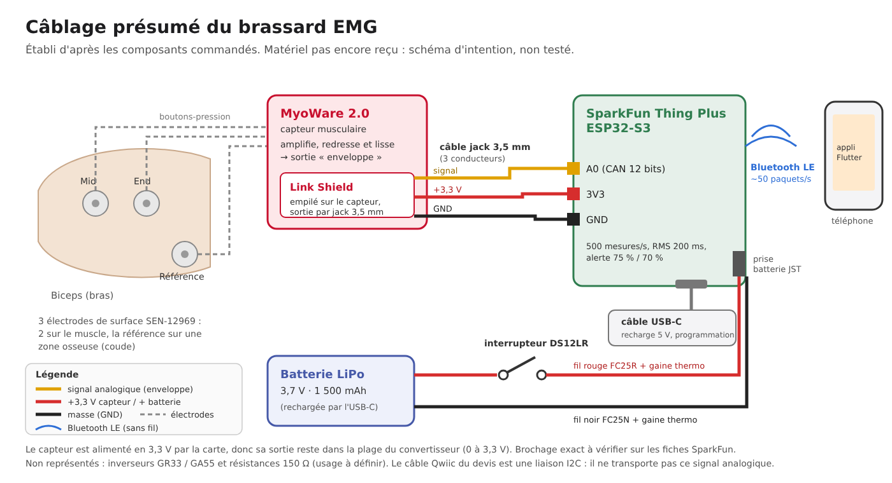
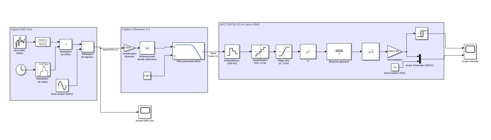
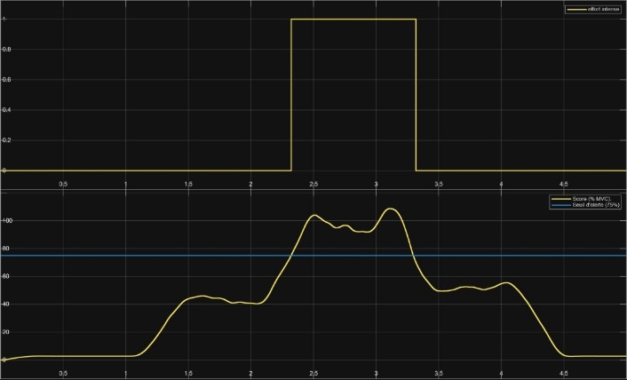

# Athletix-Data

**🇫🇷 Français** · [🇬🇧 English](#english)

Brassard connecté qui mesure l'activité d'un muscle (électromyographie, EMG) et application de suivi sportif. Projet de groupe réalisé à l'EPISEN de février à juin 2026.

## L'équipe

| Membre | Rôle | Tâches principales |
|---|---|---|
| **Valentin Auger** | Matériel et application | schéma électrique du brassard, firmware ESP32, acquisition et calcul RMS ; dans le dépôt : l'**application Flutter** (écrans, questionnaire, conseils, classement, mode démo et démo en ligne), l'**API PHP** et la base de données (comptes, profils, classement), le [câblage présumé du brassard](hardware/README.md), la première piste du capteur cardiaque (code ESP32, simulation Wokwi) et la documentation |
| **Maxence Olivier** | Chef de projet et qualité | planning (Gantt, MPM), documentation technique, conformité, tests ; dans le dépôt : la **simulation Simulink de la chaîne EMG** ([`hardware/simulation-emg/`](hardware/simulation-emg/README.md)), modèle et résultats |
| **Othmen Al Bydeoi** | Architecture système | architecture Bluetooth Low Energy (GATT), intégration réseau, modèles de données (MCD, MLD, MCT), schémas ; dans le dépôt : la spécification [`architecture/`](architecture/README.md), le brassard simulé et l'écran de séance EMG de l'appli, l'enregistrement des séances et des calibrations (API PHP + [`migrations/`](migrations/001_brassard_emg.sql)), le firmware de test [`hardware/faux-brassard-ble/`](hardware/faux-brassard-ble/README.md) et les tests |

## Le brassard (version finale)

| Composant | Rôle |
|---|---|
| Capteur musculaire **MyoWare 2.0** + électrodes de surface | amplifie, redresse et lisse le signal du muscle (sortie analogique « enveloppe ») |
| **MyoWare 2.0 Link Shield** | relie le capteur au microcontrôleur |
| **SparkFun Thing Plus ESP32-S3** | conversion 12 bits à 500 Hz, valeur efficace sur 200 ms, envoi en Bluetooth Low Energy (~50 Hz, paquets de 8 octets) |
| Batterie **LiPo 3,7 V 1 500 mAh** + interrupteur | autonomie visée : plus de 2 h (environ 10 h estimées) |
| Brassard élastique | maintien sur le biceps |

La chaîne de mesure a été modélisée sous Simulink par Maxence Olivier avant le câblage, à titre d'**expérimentation** : voir [`hardware/simulation-emg/`](hardware/simulation-emg/README.md). Dans ce modèle d'essai, l'intensité calculée suit l'effort demandé, et l'alerte d'effort intense (75 %, avec hystérésis) ne clignote pas. Le modèle final est fourni : [`AthletixData_EMG_Simulation.slx`](hardware/simulation-emg/AthletixData_EMG_Simulation.slx) (MATLAB/Simulink R2026b ou plus récent).

**Le câblage présumé** : le matériel n'est pas encore reçu, ce schéma montre comment les composants commandés seront reliés (non testé) :



**Le modèle Simulink** (signal du muscle, capteur MyoWare 2.0, puis conversion et calcul sur l'ESP32-S3) :



**Le résultat** : en haut, l'alerte d'effort intense ; en bas, l'intensité en % de la contraction maximale, avec le seuil de 75 % :



## Rencontre avec une patiente atteinte de sclérose en plaques

> [!NOTE]
> Pendant le projet, l'équipe s'est entretenue avec **une personne atteinte de sclérose en plaques**, à l'initiative d'**un médecin retraité spécialiste de cette maladie**, qui nous a poussés à orienter le brassard vers ce besoin. Cet échange nous a aidés à avancer. Ses suggestions n'ont pas été notées sur le moment : les pistes ci-dessous ont été **rédigées après coup** à partir de ce que l'on sait de la maladie. Ce ne sont ni ses mots, ni un avis médical.

| Ce que vit la personne | Ce qu'il faudrait ajouter au brassard et à l'application |
|---|---|
| **Fatigue** : c'est le symptôme le plus fréquent, et elle arrive vite | suivre la fatigue musculaire (baisse de la fréquence médiane du signal brut, sortie RAW du MyoWare lue à 1 kHz ou plus) et proposer une pause **avant** l'épuisement, pas seulement une alerte d'effort intense |
| **Sensibilité à la chaleur** : les symptômes s'aggravent quand le corps chauffe | ajouter un capteur de température de la peau, une alerte de pause et des conseils pour se rafraîchir |
| **Force qui change d'un jour à l'autre** | refaire la calibration (contraction maximale) au début de chaque séance au lieu d'une référence fixe, avec des seuils réglables plus bas que 75 % |
| **Raideurs et spasmes**, souvent d'un seul côté | repérer une activité du muscle au repos, comparer le côté gauche et le côté droit avec deux capteurs |
| **Gestes fins et vue parfois difficiles** | grands boutons, texte grand et bien contrasté, alertes par vibration ou par la voix, séances courtes |
| **Suivi avec les soignants** | un carnet (fatigue notée de 0 à 10, séances, pauses) exportable pour le neurologue ou le kinésithérapeute |

Ce brassard n'est **pas un dispositif médical**. Une activité physique adaptée se fait avec l'accord et le suivi des soignants, et ces données de santé devraient être protégées (consentement, RGPD).

> **Historique :** la première piste du projet utilisait un capteur cardiaque (photopléthysmographe : LED infrarouge, phototransistor, LM358) sur un ESP32 classique. Son code et sa simulation Wokwi sont conservés dans [`hardware/`](hardware/README.md). L'application a d'abord été construite à cette étape ; l'écran de séance affiche maintenant l'intensité musculaire (simulée).

▶️ **Démo en ligne (sans serveur, données fictives) :** https://valentin-auger-laboratoire.github.io/athletix-data/ puis « Essayer la démo ».

| Accueil (mode démo) | Conseils générés par règles | Séance |
|---|---|---|
|  |  |  |

## Architecture

```
Muscle ──► MyoWare 2.0 ──► ESP32-S3 ══ Bluetooth LE (GATT) ══► Application Flutter ══ HTTPS ══► API PHP ──► MySQL
                           (RMS, % MVC, alerte)                 (affichage, résumé)             (backend/)  (database.sql
                                                                                                            + migrations/)
```

Le format Bluetooth, les modèles de données (MCD, MLD, MCT) et l'intégration réseau sont décrits dans [`architecture/`](architecture/README.md). Pour l'instant, l'application utilise un **brassard simulé** qui produit les vrais paquets Bluetooth ; un firmware de test pour ESP32 est dans [`hardware/faux-brassard-ble/`](hardware/faux-brassard-ble/README.md).

| Dossier | Contenu |
|---|---|
| `lib/` | Application Flutter (écrans, `config.dart`, couche API, mode démo) |
| `backend/` | API PHP : inscription, vérification par e-mail, connexion, profils, classement, état du brassard |
| `hardware/` | Câblage présumé du brassard EMG, simulation Simulink, et fichiers du premier capteur cardiaque : code ESP32, simulation Wokwi ([détails](hardware/README.md)) |
| `architecture/` | Spécification Bluetooth (GATT), MCD / MLD, MCT, intégration réseau |
| `database.sql` | Structure de la base + 1 compte de démo fictif |
| `migrations/` | Mises à jour de la base (brassard, calibrations, résultats EMG) |
| `docs/` | Version web compilée, publiée par GitHub Pages |

## Fonctionnalités

- Inscription avec **code de vérification envoyé par e-mail** (6 chiffres, valable 10 minutes, 5 essais maximum, bouton « Renvoyer le code »).
- Connexion avec mot de passe haché (`password_hash`) et **jeton de session** ; un compte non vérifié ne peut pas se connecter.
- 5 familles de sports (environ 25 disciplines), avec un écran de séance par discipline.
- Questionnaire de profil (objectif, niveau, taille, poids, fréquence, blessures, antécédents cardio, sommeil, stress) avec **historique** des profils ; à la mise à jour, il reprend les réponses précédentes.
- Conseils calculés à partir de tout le profil : rythme selon le niveau et la fréquence déclarée, objectif, taille et poids (IMC, protéines), blessures, stress, sommeil, antécédents.
- Classement des athlètes (score total de leurs performances).
- **Mode démo** utilisable sans backend.

## Ce qui est simulé (à lire avant d'évaluer le projet)

- **Intensité musculaire** : pendant une séance, l'écran affiche le % de la contraction maximale (MVC) venant d'un **brassard simulé** (profil repos / 40 % / 95 % / 50 %). Les paquets suivent le vrai format Bluetooth, mais aucun muscle n'est mesuré, et l'écran l'indique. La séance est ensuite enregistrée comme « données simulées ».
- **Mesure propre à chaque discipline** (activité musculaire moyenne, pic de contraction, efforts intenses, relâchement, en % de la contraction maximale), affichée sous l'intensité : valeurs d'exemple fixes, marquées « valeur d'exemple ».
- **« IA »** : les conseils sont produits par des **règles `if/else`**, pas par un modèle entraîné (mention « Conseils générés par règles »). Ils ne remplacent pas un avis médical.
- **Mode démo** : compte et données **fictifs**, gardés en mémoire et perdus au rechargement de la page.
- **Simulation Simulink de la chaîne EMG** : c'est une expérimentation. Le signal du muscle est généré, la référence des 100 % (1,85 V) est supposée, et rien n'a encore été mesuré sur le vrai brassard.

## Installation

### Prérequis
- [Flutter](https://docs.flutter.dev/get-started/install) 3.x (Dart 3)
- [XAMPP](https://www.apachefriends.org/) (Apache + PHP 8 + MySQL/MariaDB)

### 1. Base de données
Démarre MySQL dans XAMPP, puis importe `database.sql` (phpMyAdmin → Importer, ou `mysql -u root < database.sql`).
Cela crée la base `athletix-pro` et un compte de démo fictif : `demo@exemple.com` / `demo1234`.
Importe ensuite `migrations/001_brassard_emg.sql` (tables du brassard, des calibrations et des résultats de séance).

### 2. Backend PHP
1. Copie (ou clone) le dépôt dans `htdocs/athletix-data` pour que l'API réponde sur `http://localhost/athletix-data/backend/`.
2. Copie `backend/config.example.php` en `backend/config.local.php` (ce fichier est ignoré par Git), puis remplis :
   - les accès MySQL ;
   - le SMTP : adresse Gmail et **mot de passe d'application** ([à créer ici](https://myaccount.google.com/apppasswords)), jamais ton vrai mot de passe ;
   - `allowed_origin` : l'origine de l'appli Flutter (par défaut `http://localhost:5000`).

### 3. Application Flutter
```bash
flutter pub get
flutter run -d chrome --web-port 5000
```
L'URL de l'API est définie à un seul endroit, `lib/config.dart`. Elle peut aussi être changée à la compilation :
```bash
flutter run -d chrome --web-port 5000 --dart-define=API_BASE_URL=https://mon-serveur.exemple/backend
```

### 4. Version web pour GitHub Pages
```bash
MSYS_NO_PATHCONV=1 flutter build web --release --base-href /athletix-data/
rm -rf docs && cp -r build/web docs && touch docs/.nojekyll
```
Ensuite, sur GitHub : *Settings → Pages → Branch `main`, dossier `/docs`*.

## Données personnelles (RGPD)

Le questionnaire porte sur des **données de santé** (poids, blessures, antécédents cardiaques, stress, sommeil), qui sont des données sensibles au sens du RGPD. Ce projet est pédagogique : **n'utilise que des données fictives**. Le mode démo n'envoie rien à un serveur. Une vraie mise en production demanderait une base légale et un consentement explicite, un hébergement adapté, HTTPS, et des droits d'accès et de suppression des données.

## Licences et crédits

- Code du projet : © 2026 équipe Athletix-Data (Valentin Auger, Maxence Olivier, Othmen Al Bydeoi).
- [PHPMailer](https://github.com/PHPMailer/PHPMailer) (dossier `PHPMailer/`, version 7.0.2) est distribué sous **licence LGPL 2.1** ; voir `PHPMailer/LICENSE`.
- Flutter et ses packages : licences BSD respectives.

---

<a id="english"></a>

# Athletix-Data (English)

A connected armband that measures muscle activity (electromyography, EMG) and a fitness-tracking app. Group project at EPISEN (French engineering school), February to June 2026.

**Team:** Valentin Auger (hardware and app: armband wiring, ESP32 firmware, acquisition and RMS; in the repository: the Flutter app with its screens, questionnaire, advice, leaderboard, demo mode and online demo, the PHP API and database, the presumed armband wiring, the first heart-rate sensor track, and the documentation), Maxence Olivier (project lead and QA; in the repository: the Simulink simulation of the EMG chain in `hardware/simulation-emg/`), Othmen Al Bydeoi (system architecture: Bluetooth Low Energy GATT, data models; in the repository: the `architecture/` specification, the simulated armband and EMG workout screen, session and calibration storage in the PHP API and `migrations/`, the `hardware/faux-brassard-ble/` test firmware, and the tests).

**Final armband:** MyoWare 2.0 muscle sensor + Link Shield, SparkFun Thing Plus ESP32-S3 (12-bit ADC at 500 Hz, 200 ms RMS, Bluetooth Low Energy), 3.7 V 1500 mAh LiPo battery. The measurement chain was first modelled in Simulink as an **experiment**: see [`hardware/simulation-emg/`](hardware/simulation-emg/README.md). The final model is included: [`AthletixData_EMG_Simulation.slx`](hardware/simulation-emg/AthletixData_EMG_Simulation.slx) (MATLAB/Simulink R2026b or later).

**Meeting with a person living with multiple sclerosis.** During the project, the team talked with a person living with multiple sclerosis, at the suggestion of a retired doctor specialised in the disease, who pushed us towards this need. Her suggestions were not written down at the time; the ideas below were **written afterwards** from what is known about the disease. They are neither her words nor medical advice:
- **Fatigue** (the most common symptom): track muscle fatigue (median frequency of the raw signal, MyoWare RAW output read at 1 kHz or more) and suggest a break before exhaustion.
- **Heat sensitivity**: add a skin temperature sensor and a break alert.
- **Strength that varies from day to day**: recalibrate the maximum contraction at the start of each session, with adjustable thresholds below 75 %.
- **Stiffness and spasms, often on one side**: detect muscle activity at rest, compare left and right with two sensors.
- **Fine movements and vision**: large buttons, large high-contrast text, vibration or voice alerts, short sessions.
- **Follow-up with carers**: an exportable log (fatigue 0–10, sessions, breaks) for the neurologist or physiotherapist.

The armband is **not a medical device**; adapted physical activity should be supervised by carers, and health data must be protected (consent, GDPR).

**History:** the project first explored a heart-rate sensor (photoplethysmograph on an ESP32); its code and Wokwi simulation are kept in `hardware/`. The app was first built at that stage; the workout screen now shows (simulated) muscle intensity.

▶️ **Live demo (no server, fictional data):** https://valentin-auger-laboratoire.github.io/athletix-data/ then “Essayer la démo” (Try the demo).

## Architecture

```
Muscle ──► MyoWare 2.0 ──► ESP32-S3 ══ Bluetooth LE (GATT) ══► Flutter app ══ HTTPS ══► PHP API ──► MySQL
```

The Bluetooth format, data models and network integration are described (in French) in [`architecture/`](architecture/README.md). For now the app uses a **simulated armband** that produces the real Bluetooth packets; a test firmware for the ESP32 is in [`hardware/faux-brassard-ble/`](hardware/faux-brassard-ble/README.md).

## Features

- Sign-up with an **e-mailed verification code** (6 digits, valid for 10 minutes, at most 5 attempts, resend button).
- Login with hashed passwords (`password_hash`) and a **session token**; unverified accounts cannot log in.
- 5 sport families (about 25 disciplines), each with a workout screen.
- Profile questionnaire (goal, level, height, weight, frequency, injuries, cardiac history, sleep, stress) with a **history** of profiles; when updating, it starts from the previous answers.
- Advice computed from the whole profile: pace from level and declared frequency, goal, height and weight (BMI, protein), injuries, stress, sleep, history.
- Athlete leaderboard (total score of recorded performances).
- **Demo mode** that works without any backend.

## What is simulated

- **Muscle intensity**: during a workout, the % of maximum contraction comes from a **simulated armband** that follows the real Bluetooth packet format. No muscle is measured, the screen says so, and the session is saved as simulated data.
- **Discipline-specific reading** (average muscle activity, peak contraction, intense efforts, relaxation, in % of maximum contraction), shown below the intensity: fixed example values, labelled as such.
- **“AI”**: the advice comes from **if/else rules**, not a trained model. It is not medical advice.
- **Demo mode**: **fictional** account and data, kept in memory and lost when the page reloads.
- **Simulink model of the EMG chain**: an experiment. The muscle signal is generated, the 100 % reference (1.85 V) is assumed, and nothing has been measured on the real armband yet.

## Installation

1. **Database**: start MySQL (XAMPP) and import `database.sql`. This creates a fictional demo account: `demo@exemple.com` / `demo1234`.
2. **PHP backend**: place the repository in `htdocs/athletix-data`. Copy `backend/config.example.php` to `backend/config.local.php` (git-ignored), then fill in the MySQL credentials, the SMTP settings (Gmail address and **app password**) and `allowed_origin`.
3. **Flutter app**: run `flutter pub get`, then `flutter run -d chrome --web-port 5000`. The API URL lives in `lib/config.dart`, or can be passed with `--dart-define=API_BASE_URL=...`.
4. **GitHub Pages**: `MSYS_NO_PATHCONV=1 flutter build web --release --base-href /athletix-data/`, copy `build/web` to `docs/`, add `docs/.nojekyll`, then enable Pages on `main` / `docs`.

## Personal data (GDPR)

The questionnaire collects **health data**, which is sensitive data under the GDPR. This is an educational project: **use fictional data only**. Demo mode sends nothing to any server.

## Licences

- Project code: © 2026 Athletix-Data team (Valentin Auger, Maxence Olivier, Othmen Al Bydeoi).
- [PHPMailer](https://github.com/PHPMailer/PHPMailer) (`PHPMailer/` folder, v7.0.2) is distributed under the **LGPL 2.1** licence; see `PHPMailer/LICENSE`.
