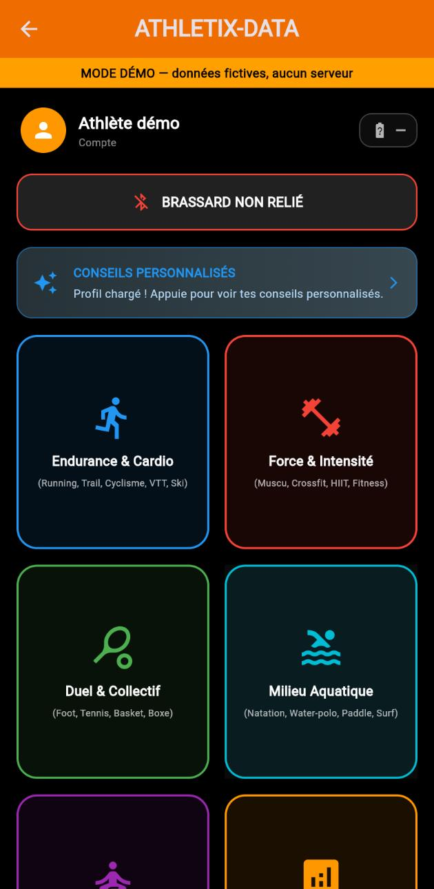
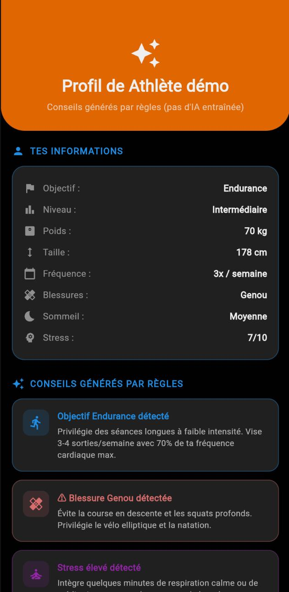
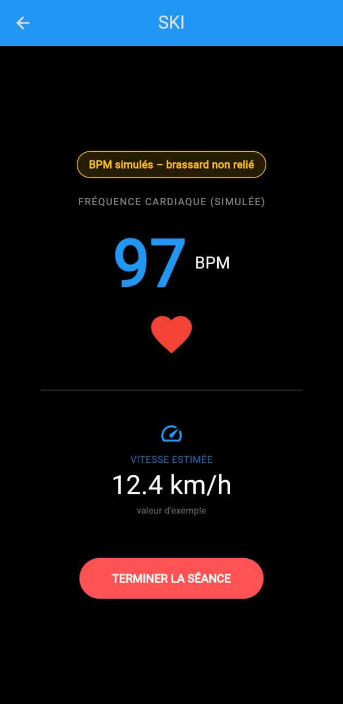

# Athletix-Data

**🇫🇷 Français** · [🇬🇧 English](#english)

Application de suivi sportif conçue pour fonctionner avec un **brassard cardiaque** (photopléthysmographe sur ESP32). Projet réalisé en 2026.

▶️ **Démo en ligne (sans serveur, données fictives) :** https://valentin-auger-laboratoire.github.io/athletix-data/ puis « Essayer la démo ».

| Accueil (mode démo) | Conseils générés par règles | Séance |
|---|---|---|
|  |  |  |

## Architecture

```
Capteur PPG (LED IR + phototransistor + LM358)
        │  signal analogique
        ▼
ESP32 (hardware/sketch.ino) ──► port série          ⚠️ pas encore relié à l'appli
        ┊
        ┊  (prévu : Bluetooth / Wi-Fi → update_hardware.php)
        ▼
Application Flutter Web (lib/) ──HTTP POST──► API PHP (backend/) ──► MySQL (database.sql)
```

| Dossier | Contenu |
|---|---|
| `lib/` | Application Flutter (écrans, `config.dart`, couche API, mode démo) |
| `backend/` | API PHP : inscription, vérification par e-mail, connexion, profils, classement, état du brassard |
| `hardware/` | Code ESP32, simulation Wokwi, script du schéma de montage ([détails](hardware/README.md)) |
| `database.sql` | Structure de la base + 1 compte de démo fictif |
| `docs/` | Version web compilée, publiée par GitHub Pages |

## Fonctionnalités

- Inscription avec **code de vérification envoyé par e-mail** (6 chiffres, valable 10 minutes, 5 essais maximum, bouton « Renvoyer le code »).
- Connexion avec mot de passe haché (`password_hash`) et **jeton de session** ; un compte non vérifié ne peut pas se connecter.
- 5 familles de sports (environ 25 disciplines), avec un écran de séance par discipline.
- Questionnaire de profil (objectif, niveau, taille, poids, fréquence, blessures, antécédents cardio, sommeil, stress) avec **historique** des profils.
- Conseils personnalisés calculés à partir du profil.
- Classement des athlètes (score total de leurs performances).
- **Mode démo** utilisable sans backend.

## Ce qui est simulé (à lire avant d'évaluer le projet)

- **Fréquence cardiaque** : pendant une séance, les BPM sont des valeurs **aléatoires** entre 60 et 100, et l'écran l'indique (« BPM simulés – brassard non relié »). Le capteur est lu par l'ESP32, mais il n'est pas encore relié à l'application.
- **Vitesse, répétitions, stabilité…** : valeurs d'exemple fixes, marquées « valeur d'exemple ».
- **« IA »** : les conseils sont produits par des **règles `if/else`**, pas par un modèle entraîné (mention « Conseils générés par règles »). Ils ne remplacent pas un avis médical.
- **Mode démo** : compte et données **fictifs**, gardés en mémoire et perdus au rechargement de la page.

## Installation

### Prérequis
- [Flutter](https://docs.flutter.dev/get-started/install) 3.x (Dart 3)
- [XAMPP](https://www.apachefriends.org/) (Apache + PHP 8 + MySQL/MariaDB)

### 1. Base de données
Démarre MySQL dans XAMPP, puis importe `database.sql` (phpMyAdmin → Importer, ou `mysql -u root < database.sql`).
Cela crée la base `athletix-pro` et un compte de démo fictif : `demo@exemple.com` / `demo1234`.

### 2. Backend PHP
1. Copie (ou clone) le dépôt dans `htdocs/athletix-data` pour que l'API réponde sur `http://localhost/athletix-data/backend/`.
2. Copie `backend/config.example.php` en `backend/config.local.php` (ce fichier est ignoré par Git), puis remplis :
   - les accès MySQL ;
   - le SMTP : adresse Gmail et **mot de passe d'application** ([à créer ici](https://myaccount.google.com/apppasswords)), jamais ton vrai mot de passe ;
   - `allowed_origin` : l'origine de l'appli Flutter (par défaut `http://localhost:5000`).

### 3. Application Flutter
```bash
flutter pub get
flutter run -d chrome --web-port 5000
```
L'URL de l'API est définie à un seul endroit, `lib/config.dart`. Elle peut aussi être changée à la compilation :
```bash
flutter run -d chrome --web-port 5000 --dart-define=API_BASE_URL=https://mon-serveur.exemple/backend
```

### 4. Version web pour GitHub Pages
```bash
MSYS_NO_PATHCONV=1 flutter build web --release --base-href /athletix-data/
rm -rf docs && cp -r build/web docs && touch docs/.nojekyll
```
Ensuite, sur GitHub : *Settings → Pages → Branch `main`, dossier `/docs`*.

## Données personnelles (RGPD)

Le questionnaire porte sur des **données de santé** (poids, blessures, antécédents cardiaques, stress, sommeil), qui sont des données sensibles au sens du RGPD. Ce projet est pédagogique : **n'utilise que des données fictives**. Le mode démo n'envoie rien à un serveur. Une vraie mise en production demanderait une base légale et un consentement explicite, un hébergement adapté, HTTPS, et des droits d'accès et de suppression des données.

## Licences et crédits

- Code du projet : © 2026 Valentin Auger.
- [PHPMailer](https://github.com/PHPMailer/PHPMailer) (dossier `PHPMailer/`, version 7.0.2) est distribué sous **licence LGPL 2.1** ; voir `PHPMailer/LICENSE`.
- Flutter et ses packages : licences BSD respectives.

---

<a id="english"></a>

# Athletix-Data (English)

A fitness-tracking app designed to work with a **heart-rate armband** (photoplethysmograph on an ESP32). Built in 2026.

▶️ **Live demo (no server, fictional data):** https://valentin-auger-laboratoire.github.io/athletix-data/ then “Essayer la démo” (Try the demo).

## Architecture

```
PPG sensor (IR LED + phototransistor + LM358)
        │  analog signal
        ▼
ESP32 (hardware/sketch.ino) ──► serial port         ⚠️ not yet connected to the app
        ┊
        ┊  (planned: Bluetooth / Wi-Fi → update_hardware.php)
        ▼
Flutter Web app (lib/) ──HTTP POST──► PHP API (backend/) ──► MySQL (database.sql)
```

## Features

- Sign-up with an **e-mailed verification code** (6 digits, valid for 10 minutes, at most 5 attempts, resend button).
- Login with hashed passwords (`password_hash`) and a **session token**; unverified accounts cannot log in.
- 5 sport families (about 25 disciplines), each with a workout screen.
- Profile questionnaire (goal, level, height, weight, frequency, injuries, cardiac history, sleep, stress) with a **history** of profiles.
- Personalised advice computed from the profile.
- Athlete leaderboard (total score of recorded performances).
- **Demo mode** that works without any backend.

## What is simulated

- **Heart rate**: during a workout, BPM values are **random** numbers between 60 and 100, and the screen says so. The ESP32 reads the sensor, but it is not yet connected to the app.
- **Speed, reps, stability…**: fixed example values, labelled as such.
- **“AI”**: the advice comes from **if/else rules**, not a trained model. It is not medical advice.
- **Demo mode**: **fictional** account and data, kept in memory and lost when the page reloads.

## Installation

1. **Database**: start MySQL (XAMPP) and import `database.sql`. This creates a fictional demo account: `demo@exemple.com` / `demo1234`.
2. **PHP backend**: place the repository in `htdocs/athletix-data`. Copy `backend/config.example.php` to `backend/config.local.php` (git-ignored), then fill in the MySQL credentials, the SMTP settings (Gmail address and **app password**) and `allowed_origin`.
3. **Flutter app**: run `flutter pub get`, then `flutter run -d chrome --web-port 5000`. The API URL lives in `lib/config.dart`, or can be passed with `--dart-define=API_BASE_URL=...`.
4. **GitHub Pages**: `MSYS_NO_PATHCONV=1 flutter build web --release --base-href /athletix-data/`, copy `build/web` to `docs/`, add `docs/.nojekyll`, then enable Pages on `main` / `docs`.

## Personal data (GDPR)

The questionnaire collects **health data**, which is sensitive data under the GDPR. This is an educational project: **use fictional data only**. Demo mode sends nothing to any server.

## Licences

- Project code: © 2026 Valentin Auger.
- [PHPMailer](https://github.com/PHPMailer/PHPMailer) (`PHPMailer/` folder, v7.0.2) is distributed under the **LGPL 2.1** licence; see `PHPMailer/LICENSE`.
