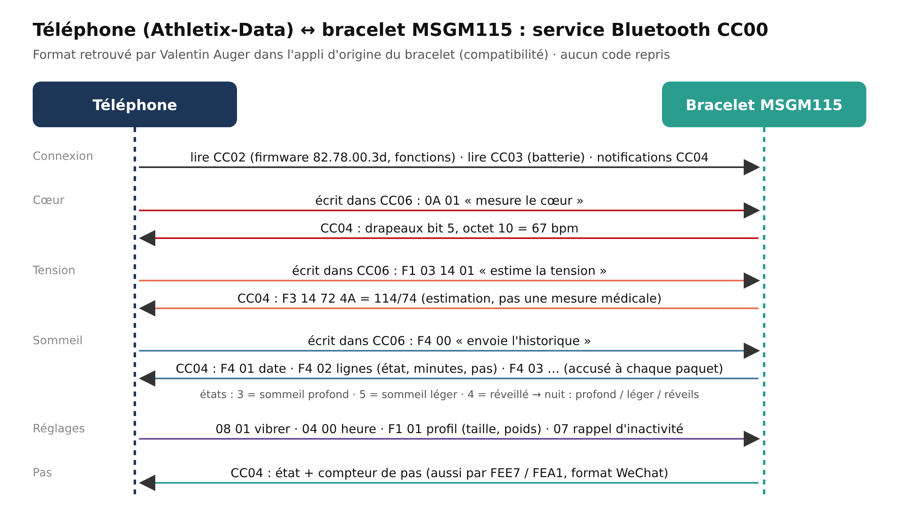

# Bracelet YOHO (MSGM115) : format Bluetooth du service CC00

Fiche rédigée le 13 novembre 2026. Le bracelet MSGM115 de Valentin Auger (« YOHO » au démarrage, puce Maxscend, firmware **82.78.00.3d**) a un service propre au fabricant, **0xCC00**, en plus du podomètre « WeChat » (FEE7). Son format a été retrouvé en analysant l'appli d'origine du bracelet (Yoho Sports, récupérée par Valentin sur un second téléphone), **uniquement pour rendre son bracelet compatible avec Athletix-Data** (directive 2009/24/CE, article 6). Aucun code de l'appli d'origine n'est repris : cette fiche et `lib/services/telephone/protocole_yoho.dart` décrivent seulement le format des messages, réécrit pour le projet.

> ⚠️ Le bracelet **estime** la tension à partir de son capteur optique : ce n'est pas une mesure au brassard. Athletix-Data n'est pas un dispositif médical.

État : format codé et testé (`test/montre_yoho_test.dart`, 16 tests), **pas encore essayé avec le bracelet** (à faire avec l'APK sur un téléphone Android).



**Démo** : un bracelet simulé (`lib/services/telephone/montre_yoho_simulee.dart`) renvoie ces mêmes octets ; il est proposé dans la démo en ligne (BRASSARD NON RELIÉ → « Démo : bracelet MSGM115 simulé »).

## Caractéristiques

| UUID | Accès | Rôle |
|---|---|---|
| CC02 | lecture | informations : version (octets 12.13.14.11 en hexadécimal), fonctions (octet 17 : bit 4 cœur, bit 5 tension ; octet 15 bit 2 : historique des mesures) |
| CC03 | lecture, notification | batterie : octet 0 = %, octet 7 = état de charge |
| CC04 | notification | messages du bracelet (tableau ci-dessous) |
| CC05 | notification | ancien format de synchronisation (firmwares ≤ 0x49), non utilisé |
| CC06 | écriture | commandes du téléphone |

Les services **FD00** (FD01/FD02) servent aux mises à jour du firmware et aux cadrans : Athletix-Data n'y touche pas.

Ordre de connexion (comme l'appli d'origine) : lire CC02, lire CC03, notifications CC03 puis CC04, mettre à l'heure.

## Commandes (CC06)

| Octets | Effet |
|---|---|
| `0A 01` / `0A 00` | démarrer / arrêter la mesure du cœur |
| `F1 03 14 01` / `F1 03 14 00` | démarrer / arrêter l'estimation de la tension |
| `08 01` | faire vibrer le bracelet (« Trouver band ») |
| `04 00 AA MM JJ hh mm ss` | mettre à l'heure (AA = année − 2000) |
| `07 m DD DD` | rappel d'inactivité : m = 1 marche / 0 arrêt, durée en minutes sur 2 octets little-endian |
| `F1 01 s âge taille poids poignet unité OO OO` | profil (s = 0 homme / 1 femme, taille en cm, poids en kg, unité 0 = km, objectif de pas sur 2 octets LE) |
| `F4 00` | démarrer la synchronisation de l'historique d'activité |
| `F4 04` | démarrer la synchronisation de l'historique cœur / tension |

## Messages du bracelet (CC04)

| Début | Contenu |
|---|---|
| `F3 14 S D` | tension estimée S/D (mmHg) |
| `F3 1B T …` | température : T / 10 + 30 °C |
| `F3 18` | le bracelet cherche le téléphone |
| `F5 c` | bouton musique |
| `F4 …` | synchronisation (ci-dessous) |
| autres | mot de drapeaux sur 2 octets LE : bit 5 → **cœur** à l'octet 10 ; bit 2 → inactivité détectée ; bit 3 → selfie ; sinon **pas** : état (octet 2) et compteur depuis minuit (octets 3–6, LE) |

États d'activité : 0 immobile, 1 marche, 2 course, **3 sommeil profond**, 4 réveillé, **5 sommeil léger**.

## Synchronisation

```
téléphone → F4 00
bracelet  → F4 01 AA MM JJ hh mm ss          (date de base ; tout à 0 = rien à envoyer)   téléphone → F4 01
bracelet  → F4 02 n° n° N [état min min pas pas] × N                                     téléphone → F4 02 n° n°
bracelet  → F4 03 état min min pas pas AA MM JJ hh mm ss   (état actuel)                 téléphone → F4 03
téléphone → F4 04                        (si le bracelet garde l'historique des mesures)
bracelet  → F4 05 AA MM JJ hh mm ss                                                      téléphone → F4 05
bracelet  → F4 06 n° n° N [s s s s v1 v2] × N                                            téléphone → F4 06 n° n°
bracelet  → F4 07                                                                        téléphone → F4 07
```

Chaque ligne d'activité commence à « base + minutes ». Chaque mesure est à « base + secondes » : v2 = 0 → cœur (v1 bpm) ; v2 = 3 → température ; sinon tension v1/v2. L'appli d'origine attend 100 ms avant chaque accusé ; Athletix-Data aussi.

**Nuit** : de 21 h la veille à 9 h, chaque état dure jusqu'au suivant ; profond = état 3, léger = état 5, un réveil = un retour au sommeil après l'état 4 ou 0. Calcul simplifié par rapport à l'appli d'origine : les durées peuvent différer un peu de celles qu'elle affiche (8 h 21 dont 15 min de profond, nuit du 12 au 13 novembre) ; à comparer lors de l'essai.

## Non décodé (pas utile au projet)

Notifications (appels, SMS, applis), météo, cadrans, réveil intelligent, mises à jour du firmware. La **musique** n'a pas besoin de code : le bracelet se comporte comme un clavier Bluetooth (touches multimédia) une fois appairé dans les réglages Bluetooth du téléphone.
