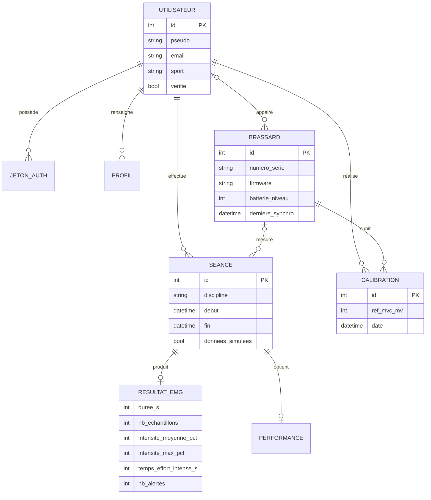

# Modèle de données : MCD et MLD

> Auteur : Othmen Al Bydeoi — architecture système. Version 1.0 (novembre 2026).

Ce document décrit **quelles informations l'application garde, et comment elles sont reliées**. Il part de la base existante (`database.sql`), relève ses défauts, puis propose le modèle cible pour le brassard EMG. La migration correspondante est dans [`migrations/001_brassard_emg.sql`](../migrations/001_brassard_emg.sql).

## 1. Le modèle actuel et ses défauts

La base actuelle a 6 tables : `users`, `auth_tokens`, `profil_ia`, `sessions_entrainement`, `performances`, `hardware_status`.

| # | Défaut | Pourquoi c'est un problème | Correction |
|---|---|---|---|
| D1 | `performances.user_id` répète `sessions_entrainement.user_id` | la même info est stockée deux fois et peut devenir contradictoire (non-respect de la 3ᵉ forme normale) | retirer la colonne et passer par la séance (prévu en v2, voir §5) |
| D2 | une séance n'a ni discipline, ni durée, ni brassard | impossible de savoir ce qui a été fait, combien de temps, avec quel appareil | colonnes `discipline`, `debut`, `fin`, `brassard_id` |
| D3 | `hardware_status` est rattaché à l'utilisateur | un brassard est un **objet** : il existe sans utilisateur, peut changer de propriétaire, a une version de firmware | nouvelle entité `BRASSARD` |
| D4 | rien pour la calibration | la référence 100 % (MVC) change d'un jour à l'autre (voir la rencontre avec la patiente atteinte de SEP dans le README) | nouvelle entité `CALIBRATION`, une ligne par calibration |
| D5 | rien pour les résultats EMG | les scores `force`, `vitesse`… ne viennent d'aucune mesure réelle | nouvelle entité `RESULTAT_EMG` |
| D6 | aucune trace des données simulées | impossible de distinguer une vraie séance d'une séance de démonstration | colonne `donnees_simulees` |

## 2. MCD (modèle conceptuel)

Notation Merise : chaque lien porte ses cardinalités (minimum, maximum) des deux côtés.

Les cardinalités en clair :

| Association | Côté A | Côté B | Lecture |
|---|---|---|---|
| appaire | UTILISATEUR (0,n) | BRASSARD (0,1) | un utilisateur peut avoir plusieurs brassards ; un brassard appartient à au plus un utilisateur (il peut être neuf, sans propriétaire) |
| effectue | UTILISATEUR (0,n) | SÉANCE (1,1) | une séance appartient toujours à un seul utilisateur |
| mesure | BRASSARD (0,n) | SÉANCE (0,1) | une séance peut se faire sans brassard (mode simulé) |
| subit / réalise | BRASSARD (0,n), UTILISATEUR (0,n) | CALIBRATION (1,1) | une calibration est faite par une personne, sur un brassard |
| produit | SÉANCE (0,1) | RÉSULTAT_EMG (1,1) | une séance a au plus un résumé EMG |

**Choix important : on ne stocke pas le signal brut.** Le brassard envoie 50 mesures par seconde, soit 180 000 lignes pour une heure. MySQL n'est pas fait pour ça, et ce sont des données de santé à minimiser (RGPD). L'application calcule donc un **résumé** à la fin de la séance, et seul ce résumé va dans la base.

## 3. MLD (modèle logique)

Clé primaire **soulignée**, clé étrangère précédée de **#**.

- USERS (<u>id</u>, pseudo, email, password_hash, sport, verified, verification_code, verification_expires, verification_attempts, created_at)
- AUTH_TOKENS (<u>id</u>, #user_id, token_hash, expires_at, created_at)
- PROFIL_IA (<u>id</u>, #user_id, objectif_principal, niveau_sportif, poids, taille, frequence, pathologies_blessures, qualite_sommeil, niveau_stress, antecedents_cardio_perso, antecedents_cardio_famille, created_at)
- **BRASSARDS** (<u>id</u>, #user_id *(nullable)*, numero_serie *(unique)*, firmware, batterie_niveau, derniere_synchro, created_at)
- **CALIBRATIONS** (<u>id</u>, #brassard_id, #user_id, ref_mvc_mv, created_at)
- SESSIONS_ENTRAINEMENT (<u>id</u>, #user_id, **#brassard_id** *(nullable)*, **discipline**, **debut**, **fin**, **donnees_simulees**, created_at)
- **RESULTATS_EMG** (<u>#session_id</u>, duree_s, nb_echantillons, intensite_moyenne_pct, intensite_max_pct, temps_effort_intense_s, nb_alertes, ref_mvc_mv)
- PERFORMANCES (<u>id</u>, #session_id, #user_id, score_force, score_endurance, score_vitesse, score_technique, score_recuperation) — *inchangée pour l'instant (D1)*
- HARDWARE_STATUS (<u>#user_id</u>, connecte, batterie_niveau, derniere_synchro) — *gardée pour ne pas casser l'app actuelle, à remplacer par BRASSARDS*

En gras : ce qui est nouveau. `RESULTATS_EMG` utilise `session_id` comme clé primaire, ce qui garantit la cardinalité (0,1) : une séance ne peut pas avoir deux résumés.

## 4. Règles de gestion

| Règle | Où elle est appliquée |
|---|---|
| R1. Un numéro de série identifie un seul brassard | `UNIQUE (numero_serie)` |
| R2. Supprimer un utilisateur supprime ses séances, calibrations et résultats, mais **pas** ses brassards (ils redeviennent sans propriétaire) | `ON DELETE CASCADE` / `ON DELETE SET NULL` |
| R3. La référence MVC est entre 100 et 3300 mV (plage du convertisseur 0–3,3 V) | `save_calibration.php` |
| R4. Les intensités vont de 0 à 255 % (format du paquet GATT) | `save_seance.php` |
| R5. Le temps d'effort intense ne peut pas dépasser la durée de la séance | `save_seance.php` |
| R6. Le début et la fin d'une séance sont fixés par le **serveur**, pas par le téléphone (son horloge peut être fausse) | `save_seance.php` |

## 5. Décisions (mise à jour du 12 novembre 2026)

- **D1 et le classement : règle de score validée et codée** (`backend/get_classement.php`, validée le 12 novembre 2026). Sur les 30 derniers jours, chaque séance **mesurée** rapporte `10 + minutes × intensité moyenne ÷ 50` points. Les 10 points récompensent la régularité, la deuxième partie le travail musculaire réellement fourni. Exemple : 30 min à 40 % MVC = 10 + 24 = 34 points. Les séances faites avec le brassard simulé (`donnees_simulees = 1`) ne comptent pas. La table `performances` est supprimée (migration `002`), ce qui règle aussi la redondance D1.
- **`hardware_status` supprimée** (migration `002`) : l'état du brassard (batterie, dernière synchronisation) est porté par `brassards`, mis à jour par l'application à chaque calibration ou séance (champ `batterie`).
