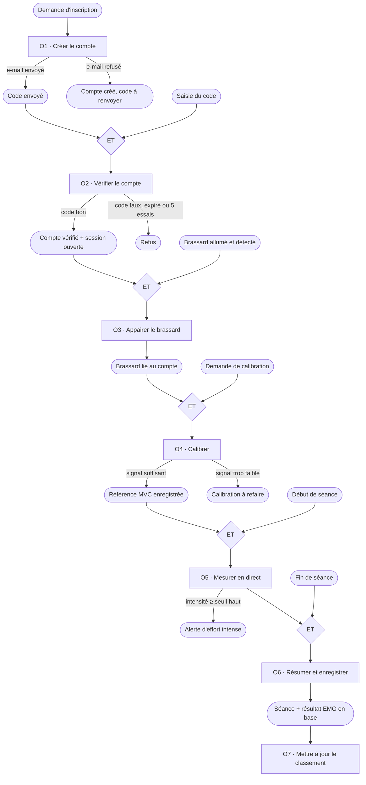

# Modèle conceptuel des traitements (MCT)

> Auteur : Othmen Al Bydeoi — architecture système. Version 1.0 (novembre 2026).

Le MCT décrit **ce que fait le système quand quelque chose arrive**, sans dire encore avec quel langage ou quel écran. Chaque traitement se lit ainsi :

> **événement(s)** → (synchronisation) → **opération** → **résultat(s)**, selon une règle d'émission.

La synchronisation dit quels événements doivent être réunis pour lancer l'opération (« ET », « OU »).

## Vue d'ensemble

## Détail des opérations

| Opération | Événements déclencheurs | Ce qui est fait | Règles d'émission → résultats | Qui |
|---|---|---|---|---|
| **O1 · Créer le compte** | demande d'inscription (pseudo, e-mail, mot de passe, sport) | vérifier les champs, hacher le mot de passe, créer l'utilisateur non vérifié, générer un code à 6 chiffres valable 10 min | e-mail envoyé → « code envoyé » ; sinon → « compte créé, renvoyer le code » | `register.php` |
| **O2 · Vérifier le compte** | ET (code envoyé, saisie du code) | comparer le code, compter les essais | bon code → compte vérifié + jeton de session ; faux / expiré / 5 essais → refus | `verify_code.php` |
| **O3 · Appairer le brassard** | ET (utilisateur connecté, brassard détecté en Bluetooth) | lire le numéro de série et le firmware (GATT `0x180A`), enregistrer le brassard au nom de l'utilisateur | toujours → brassard lié | app + `save_calibration.php` / `save_seance.php` (enregistrement à la première utilisation) |
| **O4 · Calibrer** | ET (brassard lié, demande de calibration) | commande GATT `0x03` ; l'utilisateur serre le muscle au maximum pendant 3 s ; le brassard garde la valeur RMS la plus haute | ≥ 100 mV → référence enregistrée ; sinon → erreur « calibration invalide » | brassard + app + `save_calibration.php` |
| **O5 · Mesurer en direct** | ET (référence connue, début de séance) | commande `0x01` ; 50 paquets/s ; affichage du % MVC | intensité ≥ seuil haut (75 %) → alerte, qui s'arrête seulement sous le seuil bas (70 %) | brassard + app |
| **O6 · Résumer et enregistrer** | ET (séance en cours, fin de séance) | commande `0x02` ; calcul de la durée, de l'intensité moyenne et maximale, du temps en effort intense, du nombre d'alertes | toujours → séance et résultat enregistrés | app (`ResumeSeance`) + `save_seance.php` |
| **O7 · Mettre à jour le classement** | résultat enregistré | recalculer les scores | toujours → classement à jour | `get_classement.php` (règle de score à décider, voir `MCD_MLD.md` §5) |

## Modèle organisationnel (qui fait quoi, où)

Le MCT ne dit pas *où* chaque opération tourne ; le tableau suivant le précise.

| Opération | Brassard (ESP32-S3) | Application | Serveur (PHP + MySQL) |
|---|---|---|---|
| O1, O2 | — | formulaires | ✅ |
| O3 | annonce, n° de série | scan, connexion | enregistrement |
| O4 | ✅ mesure du maximum | bouton, consignes | historique |
| O5 | ✅ RMS, % MVC, alerte | ✅ affichage | — |
| O6 | arrêt du flux | ✅ calcul du résumé | ✅ enregistrement |
| O7 | — | affichage | ✅ |

**Pourquoi l'alerte est calculée dans le brassard et pas dans l'app ?** Elle doit marcher même si le téléphone est loin ou si la connexion Bluetooth coupe un instant. Plus tard, le brassard pourra vibrer de lui-même (piste issue de la rencontre avec la patiente atteinte de SEP).
