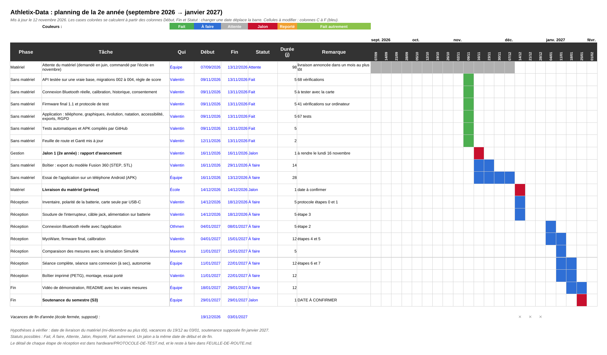
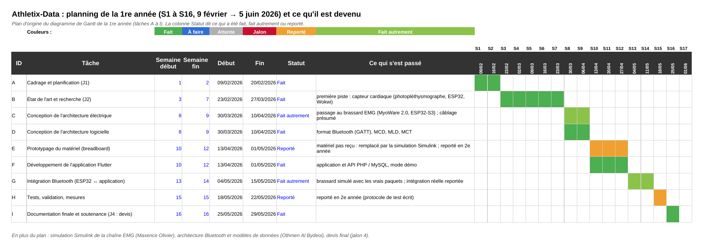

# Gestion de projet

| Fichier | Contenu |
|---|---|
| [`gantt.xlsx`](gantt.xlsx) | Diagramme de Gantt modifiable (Excel ou LibreOffice). Les barres se calculent à partir des colonnes **Début**, **Fin** et **Statut** : changer une date déplace la barre. |
| [`gantt-annee2.png`](gantt-annee2.png) | 2e année, de septembre 2026 à janvier 2027 : ce qui a été fait sans le matériel, l'attente de la commande, les étapes à la réception, la fin du projet. |
| [`gantt-annee1.png`](gantt-annee1.png) | 1re année : le plan d'origine (tâches A à I, février à juin 2026) et ce que chaque tâche est devenue (faite, faite autrement, reportée). |

Mis à jour le 12 novembre 2026. Dates à confirmer : livraison du matériel (mi-décembre au plus tôt) et soutenance du semestre (supposée fin janvier 2027).

## 2e année

## 1re année : plan d'origine et ce qu'il est devenu

