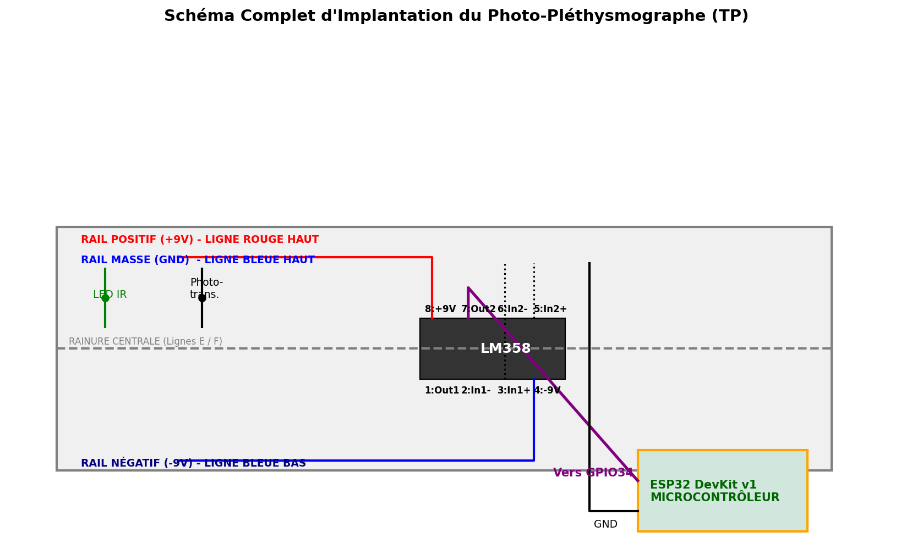

# Partie électronique — capteur cardiaque (photopléthysmographe)

> **Première piste du projet.** La version finale du brassard mesure l'activité musculaire (MyoWare 2.0 + ESP32-S3) : voir le [README principal](../README.md) et la [simulation Simulink de la chaîne EMG](simulation-emg/README.md). Ce dossier garde le travail sur le capteur cardiaque.

| Fichier | Rôle |
|---|---|
| `sketch.ino` | Programme ESP32 : lit le signal sur **GPIO34** à 50 Hz et l'envoie sur le port série (115 200 bauds) |
| `diagram.json` | Simulation Wokwi : ESP32 DevKit v1 + un **potentiomètre** qui remplace le capteur sur GPIO34 |
| `wokwi.toml` | Utile seulement pour l'extension Wokwi de VS Code (voir plus bas) |
| `schema_montage.py` | Dessine le schéma d'implantation sur breadboard (`python schema_montage.py` → `schema_montage.png`) |
| `schema_montage.png` | Schéma généré par le script |



## Montage réel

LED IR (émetteur) et phototransistor (récepteur) placés contre la peau. Le signal passe par un double ampli op **LM358** (alimentation ±9 V sur le schéma), puis sa sortie (broche 7) va vers **GPIO34**, une entrée analogique de l'ESP32.

> ⚠️ **Attention à la tension** : l'ADC de l'ESP32 accepte **0 à 3,3 V maximum**. Si le LM358 est alimenté en ±9 V, sa sortie peut dépasser 3,3 V ou devenir négative et endommager l'ESP32. Ajoute un pont diviseur et une diode de protection avant GPIO34, ou alimente l'étage de sortie en 0 / 3,3 V.

## Simulation

**Le plus simple : wokwi.com**
1. Crée un projet « ESP32 » sur https://wokwi.com.
2. Remplace le contenu de `sketch.ino` et de `diagram.json` par ceux de ce dossier.
3. Lance la simulation, puis tourne le potentiomètre : la valeur lue (0 à 4095) s'affiche dans le moniteur série.

Wokwi n'a pas de capteur PPG : le potentiomètre sert seulement à faire varier la tension sur GPIO34. L'ancien schéma (batterie Li-ion + interrupteur) a été retiré, car ces pièces n'étaient pas correctement câblées dans Wokwi et l'ESP32 y est de toute façon alimenté par l'USB simulé.

**Avec l'extension Wokwi de VS Code**
L'extension ne compile pas le code : elle charge un firmware déjà compilé. `wokwi.toml` pointait vers un build PlatformIO (`.pio/…`) absent du dépôt. Il pointe maintenant vers la sortie d'`arduino-cli` :
```bash
cd hardware
mkdir sketch && cp sketch.ino sketch/
arduino-cli compile --fqbn esp32:esp32:esp32 --output-dir build sketch
```
`hardware/build/` et `hardware/sketch/` sont ignorés par Git.

## Pas encore fait

L'ESP32 n'envoie pas encore le signal à l'application. L'étape suivante serait de calculer les BPM sur l'ESP32 (détection des pics), puis de les transmettre en Bluetooth LE ou en Wi-Fi. L'état du brassard peut déjà être enregistré avec `backend/update_hardware.php`.
