# Boîtier du brassard

Conçu par **Valentin Auger** (novembre 2026), modèle paramétrique en Python (CadQuery). **Un seul boîtier, long et fin, posé sur le biceps.** Chaque pièce est bloquée en X, Y et Z, pour que rien ne bouge quand on court, **sans aucune vis ni insert** : il n'y en a pas dans la commande, tout tient par des clips.

📄 **[Notice de montage et de pose (PDF, 2 pages)](notice-boitier.pdf)** · 🧮 **[Étude de résistance des matériaux](rdm/README.md)** ([page interactive](https://valentin-auger-laboratoire.github.io/athletix-data/boitier-rdm/))

## Vues sous Fusion 360 (Valentin Auger)

Captures faites par **Valentin Auger** dans Fusion 360, sur les fichiers STEP du dépôt (version finale, après l'étude RDM). Les blocs de couleur sont les volumes des composants : rouge = MyoWare + Link Shield, blanc et jaune = batterie et mousse, noir = interrupteur, gris = fiche jack.

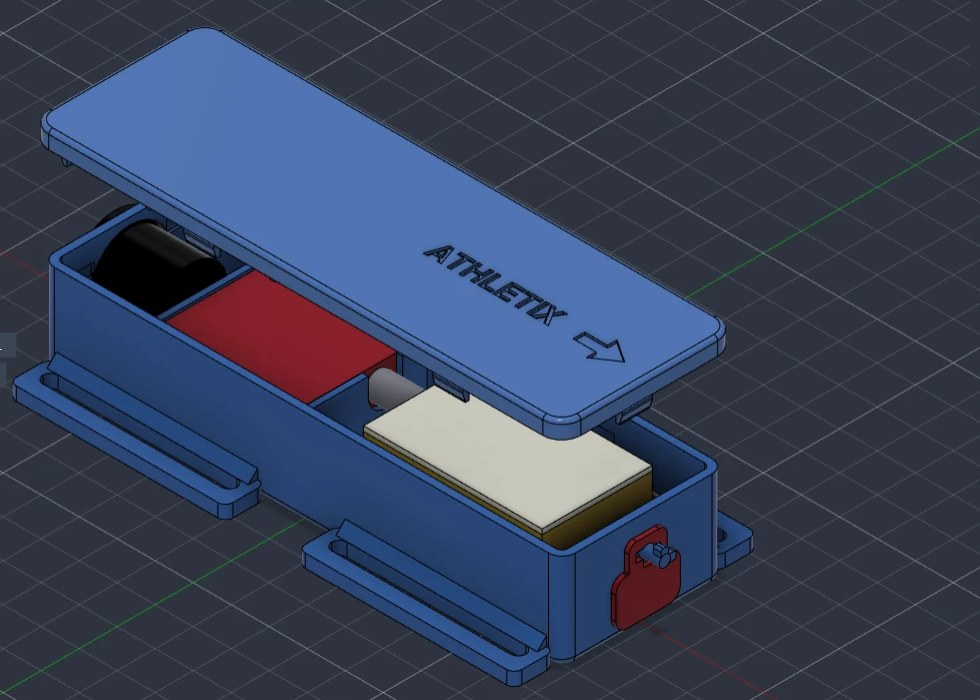
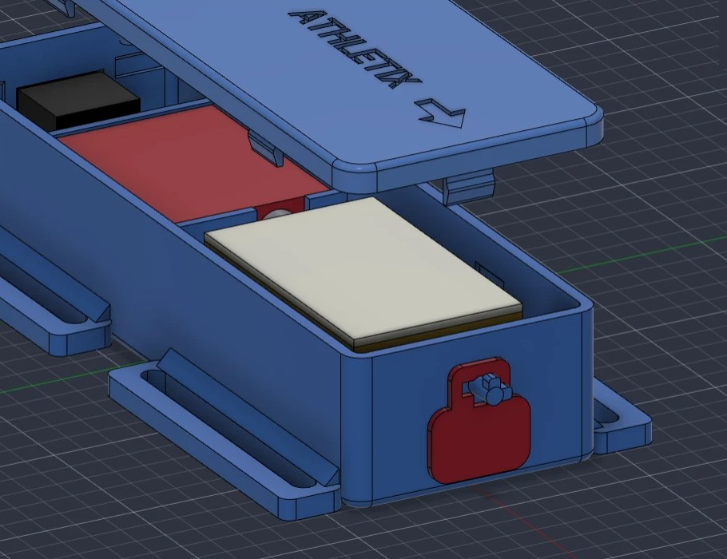

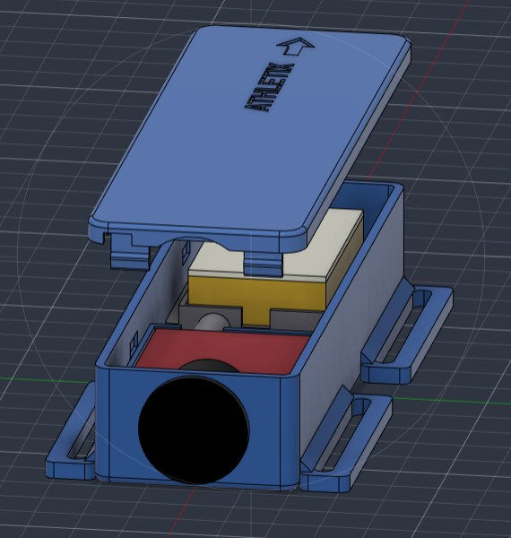
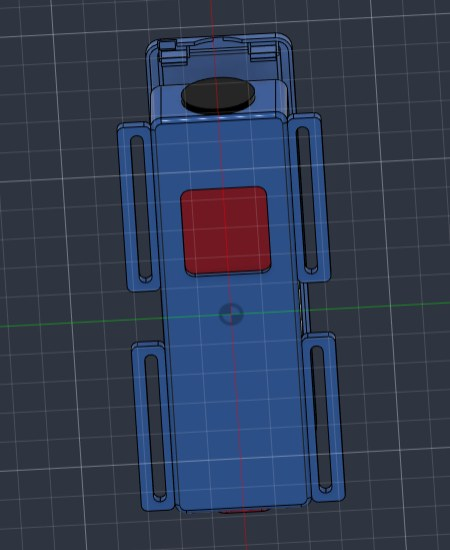
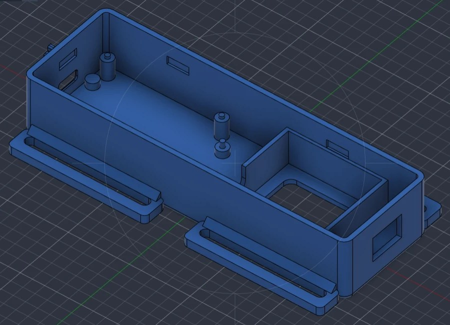

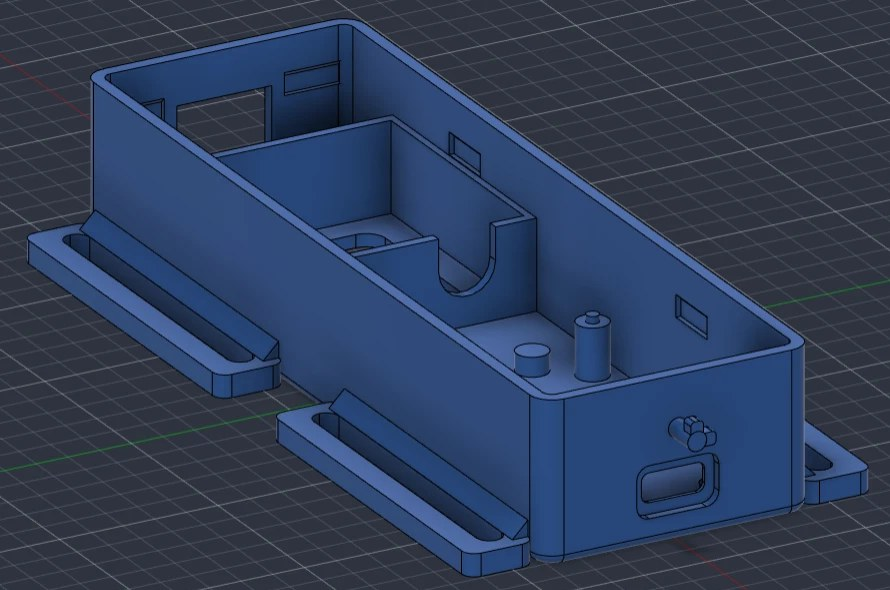
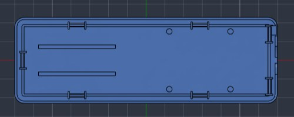

**Les points faibles corrigés, vus dans Fusion 360** (voir l'[étude RDM](rdm/README.md)) :

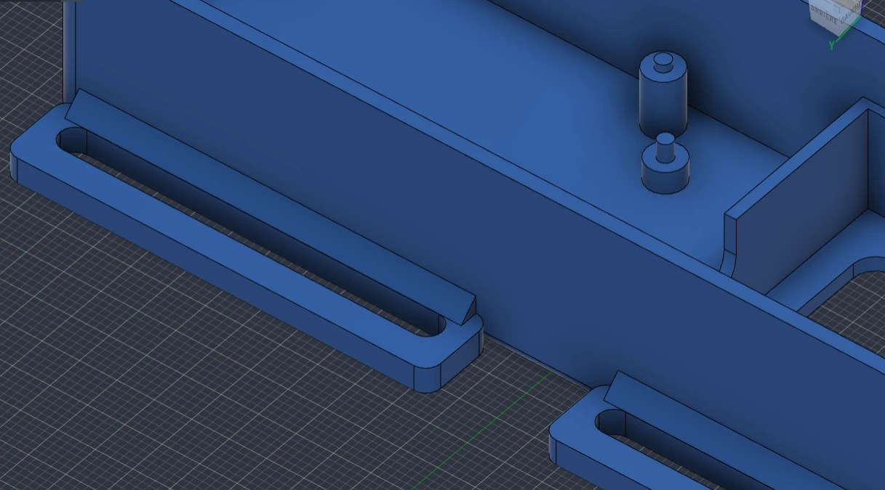
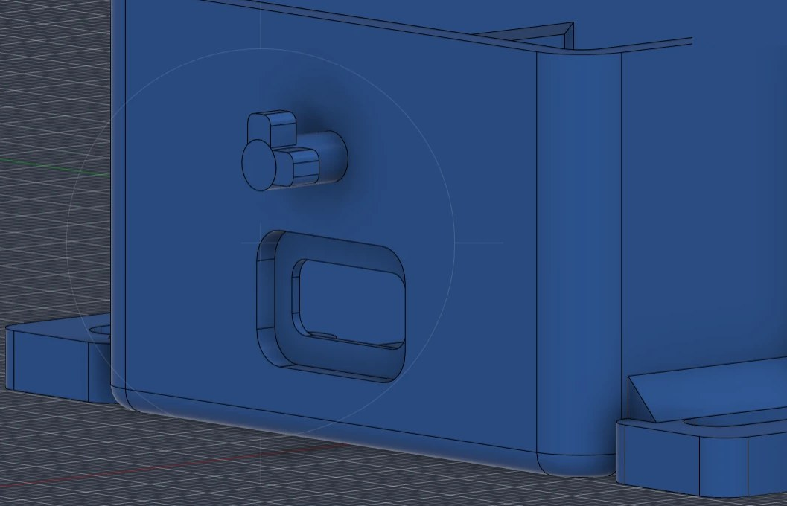
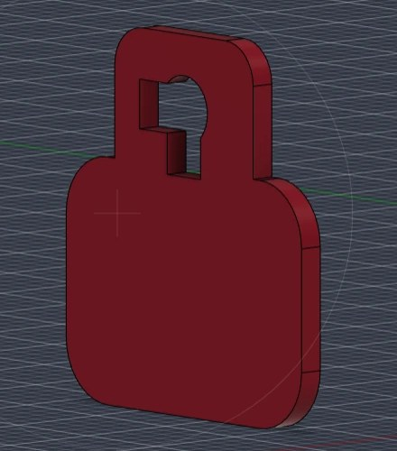

Le clip en coupe (languette accrochée dans la paroi) est montré sur l'image des [points faibles](rdm/points-faibles.png). Autres vues : [couvercle de profil](images/fusion/06-couvercle-profil.jpg), [boîtier vide DS12LR](images/fusion/07-boitier-vide-ds12lr.jpg), [ensemble en version petit interrupteur](images/fusion/12-ensemble-petit-interrupteur.jpg).

## Où se pose le boîtier, où vont les électrodes

- **Sur le devant du biceps**, dans la longueur du bras. **Flèche gravée et bout USB-C vers l'épaule**, interrupteur vers le coude : le coude se plie sans toucher le boîtier.
- **Les 3 électrodes sont sous le boîtier** : elles se clipsent sous le capteur par l'ouverture du fond, sans ouvrir le boîtier. **MID et END dans la longueur du bras**, sur la partie la plus bombée du biceps ; REF sur sa pastille. Position exacte selon le MyoWare reçu.
- **Bras gauche ou droit : même pose.**
- **Deux brassards réfléchissants du devis** (40 × 5 cm, scratch) passent dans les passants, **par-dessus le couvercle**, et font le tour du bras. Ils plaquent le boîtier, donc les électrodes, sur la peau.

## Ce qui tient chaque pièce

| Pièce | Comment elle est bloquée |
|---|---|
| Couvercle | **7 clips** (languettes souples avec un bec) qui s'enclenchent dans des creux de l'intérieur des parois ; ouverture au tournevis plat par l'encoche côté coude |
| MyoWare + Link Shield | poche à sa taille (X, Y), 4 picots du couvercle sur les coins (Z) |
| Carte Thing Plus ESP32-S3 | 4 plots, 2 pions dans ses trous (X, Y), 4 doigts sous le bac qui appuient sur les anneaux des trous (Z) |
| Batterie | bac à rebords (X, Y), mousse de 1,5 mm et nervures du couvercle (Z), sans l'écraser |
| Bac à batterie | 4 colonnes avec ergots, serré par la batterie |
| Interrupteur | clipsé dans le bout côté coude |
| Bouchon USB-C | serré dans son logement, retenu par le pion en baïonnette (il ne se perd pas) |
| Passants | tenus par la paroi sur toute leur longueur, avec un renfort triangulaire ; barre extérieure de 4 × 3,5 mm |

Le script vérifie à chaque génération qu'**aucune pièce n'en touche une autre** et que tout est plaqué (jeu de 0 mm sur le capteur, la batterie et la carte, couvercle fermé).

## Résistance

Avant d'imprimer, Valentin a fait calculer les trois pièces qui travaillent par la RDM des poutres : **clips du couvercle, barre des passants, pion du bouchon**. Sur le premier modèle, **les trois cassaient**. Le modèle a été corrigé : languette du clip de 1,0 mm, barre du passant de 4 × 3,5 mm au lieu de 1,2 × 3, baïonnette à la place du pion fendu. Toutes les pièces ont maintenant leur marge de sécurité. Détail, hypothèses et limites : **[`rdm/`](rdm/README.md)**, et **[page interactive](https://valentin-auger-laboratoire.github.io/athletix-data/boitier-rdm/)** pour faire varier le matériau et les efforts.

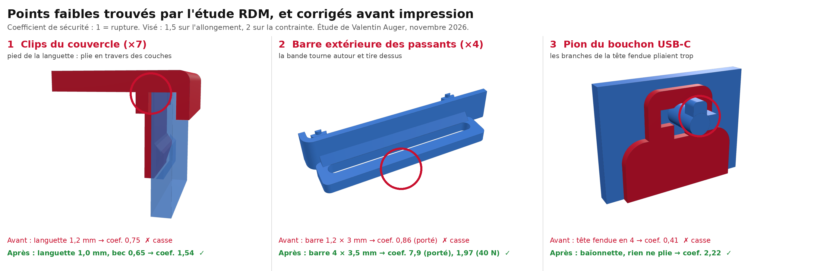

## Pluie

**Résiste à la pluie et à la transpiration, pas étanche.** Le bout USB-C est en haut quand on porte le brassard, donc :
- **jupe du couvercle** (comme le rebord d'une casquette) : l'eau qui coule sur le couvercle tombe à côté du joint ;
- **bouchon USB-C** en PETG, retiré seulement pour charger. Il est retenu par un **pion du boîtier, sans ficelle** (idée de Valentin). Ce pion est une **baïonnette à détrompeur** : 2 ailes rigides qui ne passent dans les encoches de la languette que bouchon retourné, et le couvercle empêche de le retourner. Il ne se perd pas et pivote pour charger. L'étude RDM a montré qu'une tête fendue en 4 aurait cassé ;
- plus de fenêtre sur le couvercle (l'interrupteur ENV / RAW du Link Shield reste sur RAW), interrupteur en bas.

Pas de douche ni de piscine : il faudrait un joint et des électrodes déportées, qui ne sont pas dans la commande. Pistes pour une version étanche : voir le cahier des charges plus bas.

## Fichiers

| Dossier | Contenu |
|---|---|
| [`fichiers/ds12lr/`](fichiers/ds12lr) | version interrupteur rond DS12LR : 137 × 43 × 27 mm (143 × 64 mm avec les passants) |
| [`fichiers/petit-interrupteur/`](fichiers/petit-interrupteur) | version GR33 / GA55 : 133 × 43 × 27 mm |
| [`modele/boitier.py`](modele/boitier.py) | le modèle : chaque cote est un chiffre en haut du fichier, `python boitier.py` refait tous les fichiers |
| [`modele/notice.py`](modele/notice.py) | refait la notice PDF |
| [`rdm/`](rdm/README.md) | l'étude de résistance des matériaux et ses tests |
| [`images/`](images) | rendus et schéma de pose |

Dans chaque version : `boitier`, `couvercle`, `bac-batterie`, `bouchon-usb`, `serre-bande` (boucle 3 barres de secours, si le scratch ne serre pas assez), en **STEP** (Fusion 360, SolidWorks) et **STL** (impression), plus `assemblage-complet.step`. Impression en **PETG** (bobine du devis) : les clips plient d'environ 1,3 %, sans risque en PETG.

**À vérifier au pied à coulisse avant d'imprimer** : hauteur de la pile MyoWare + Link Shield et position de la prise jack, pressions des électrodes dans l'ouverture (30 × 27 mm), trous de la carte, petit interrupteur (15 × 10 × 12 mm supposés), épaisseur du brassard (2 mm supposés). Liste complète dans la [notice](notice-boitier.pdf).

---

# Cahier des charges

Rédigé par **Valentin Auger** (novembre 2026) avant de recevoir les pièces, puis mis à jour avec le boîtier réalisé. Les dimensions viennent des fiches des fabricants et des revendeurs : **à vérifier au pied à coulisse** sur les pièces reçues avant d'imprimer.

## Pièces et dimensions

| Pièce | Dimensions | Ce qui compte pour le boîtier | Où dans le boîtier | Source |
|---|---|---|---|---|
| SparkFun Thing Plus ESP32-S3 | 58,4 × 22,9 mm (2,30 × 0,90 po) | 4 trous de fixation (≈ Ø 2,5 mm) ; USB-C sur un petit côté ; prise batterie JST | côté épaule, sur 4 plots ; USB-C face au logement du bout | [documentation SparkFun](https://docs.sparkfun.com/SparkFun_Thing_Plus_ESP32-S3/hardware_overview/) |
| MyoWare 2.0 | 37,6 × 35,9 mm | électrodes clipsées dessous ; témoins lumineux dessus | poche côté coude, au-dessus de la fenêtre des électrodes | [guide SparkFun](https://learn.sparkfun.com/tutorials/getting-started-with-the-myoware-20-muscle-sensor-ecosystem/myoware-20-muscle-sensor) |
| Link Shield | 37,6 × 35,9 mm (même gabarit, empilé) | prise jack 3,5 mm sur le côté ; interrupteur ENV / RAW (laissé sur RAW) | empilé sur le MyoWare ; jack par la cloison | [guide SparkFun](https://learn.sparkfun.com/tutorials/getting-started-with-the-myoware-20-muscle-sensor-ecosystem/-myoware-20-link-shield) |
| Batterie THYM-BAT 3,7 V 1 500 mAh | 47 × 29 × 10 mm, 28 g, câble ≈ 80 mm | connecteur JST-PH 2 mm ; protection intégrée contre la surcharge et les courts-circuits ; ne pas comprimer | dans le bac, au-dessus de la carte, sur une mousse de 1,5 mm | fiche Gotronic (une seule source, à vérifier) |
| Interrupteur DS12LR | perçage rond **Ø 20,5 mm**, corps de **16 mm** de profondeur | interrupteur à bascule à clipser, avec voyant rouge qui demande une résistance | bout côté coude | fiche Gotronic (une seule source, à vérifier) |
| Interrupteur GR33 / GA55 (2e version) | 15 × 10 mm, 12 mm de profondeur (**supposé**) | plus petit, sans voyant | bout côté coude | à mesurer à la réception |
| Câble audio recyclé (jack) | fiche ≈ 16 mm de long | relie le Link Shield à la carte | passage dans la cloison derrière le capteur | à mesurer |
| Brassards réfléchissants (×2) | **40 × 5 cm**, élastiques, scratch | passent dans les passants, par-dessus le couvercle | 2 paires de passants de 50 mm | fiche du produit (réf. 99381463) |

**Les résistances de 150 Ω du devis** servent très probablement au voyant de l'interrupteur DS12LR (une LED a besoin d'une résistance en série). Sur la batterie (3,7 V), le voyant consommerait environ 10 mA en permanence : à câbler seulement si on veut voir que le brassard est allumé, ou à laisser de côté pour gagner de l'autonomie.

## Exigences et réponse du boîtier

| # | Exigence | Réponse du boîtier réalisé |
|---|---|---|
| E1 | Tout tient dans le boîtier, sans comprimer la batterie | un seul boîtier de 137 × 43 × 27 mm (133 mm en petit interrupteur) ; batterie dans un bac avec 0,5 mm de jeu et une mousse de 1,5 mm |
| E2 | La carte est fixée et démontable, **sans vis** (aucune vis ni insert commandé) | 4 plots, 2 pions dans les trous, 4 doigts du bac qui la serrent ; couvercle à 7 clips, ouvert au tournevis plat |
| E3 | On recharge et programme sans ouvrir | logement USB-C dans le bout côté épaule (paroi amincie à 0,6 mm pour que la fiche entre jusqu'au bout), bouchon retiré pour charger |
| E4 | On allume et éteint sans ouvrir | interrupteur dans le bout côté coude, même pose sur les deux bras |
| E5 | Le câble jack ne s'arrache pas | il reste entièrement dans le boîtier, passage dans la cloison |
| E6 | Le capteur garde le contact avec la peau | fenêtre de 30 × 27 mm sous le capteur, électrodes clipsées par le dessous sans ouvrir ; le boîtier plaqué par les brassards appuie sur les électrodes |
| E7 | Tenue sur le bras, rien ne bouge en courant | chaque pièce bloquée en X, Y et Z (jeu de 0 mm vérifié par le modèle) ; 2 brassards par-dessus le couvercle ; boucle 3 barres de secours |
| E8 | Pas d'arête vive contre la peau | congés de 1,5 à 3,5 mm sur les arêtes |
| E9 | Imprimable avec le PETG du devis | parois de 2 mm, jeu de 0,3 mm, pièces imprimées à plat ; clips, passants et pion vérifiés par l'[étude RDM](rdm/README.md) |
| E10 | Masse raisonnable (objectif < 100 g avec la batterie) | 54 cm³ de plastique en plein (≈ 68 g de PETG à 100 % de remplissage, moins avec un remplissage partiel) ; à peser après impression |
| E11 | Résiste à la pluie et à la transpiration | jupe du couvercle, lèvre intérieure, bouchon USB-C, plus de fenêtre sur le couvercle ; **pas étanche** |

## Version étanche (natation, plus tard)

Le prototype **n'est pas étanche** ([analyse des risques](../../gestion-projet/analyse-des-risques.md)). Pour aller dans l'eau, il faudrait :

| Point faible | Solution possible |
|---|---|
| Couvercle | joint torique ou joint en TPU imprimé dans une gorge, à la place de la jupe actuelle |
| Interrupteur | le capuchon DS12CAP protège seulement des éclaboussures : pour l'immersion, interrupteur à l'intérieur (on ouvre pour allumer) ou interrupteur à aimant (ILS) |
| USB-C | le bouchon actuel n'est pas étanche : recharger couvercle ouvert, ou bouchon avec joint |
| Fenêtre des électrodes | électrodes déportées sur un câble avec presse-étoupe (PG7) ; le MyoWare n'est pas fait pour l'eau et les électrodes collent mal sur une peau mouillée |

Avant d'y mettre l'électronique : boîtier **vide** immergé 30 minutes avec un papier absorbant à l'intérieur, qui doit ressortir sec.

## Avant d'imprimer

- [ ] Mesurer chaque pièce reçue et corriger les cotes en haut de [`modele/boitier.py`](modele/boitier.py), puis relancer le script (il refait les fichiers et vérifie les collisions).
- [ ] Vérifier la position exacte de l'USB-C, des trous de la carte et des pressions des électrodes du MyoWare.
- [x] Choisir l'interrupteur : les deux versions sont prêtes (DS12LR ou GR33 / GA55).
- [x] Mesurer la largeur du brassard : 5 cm (fiche du produit) ; épaisseur de 2 mm supposée, à vérifier.
- [ ] Imprimer d'abord le couvercle seul pour essayer les clips, puis le boîtier entier.

Première étude (deux modules, vis M2,5), remplacée par le boîtier réalisé

