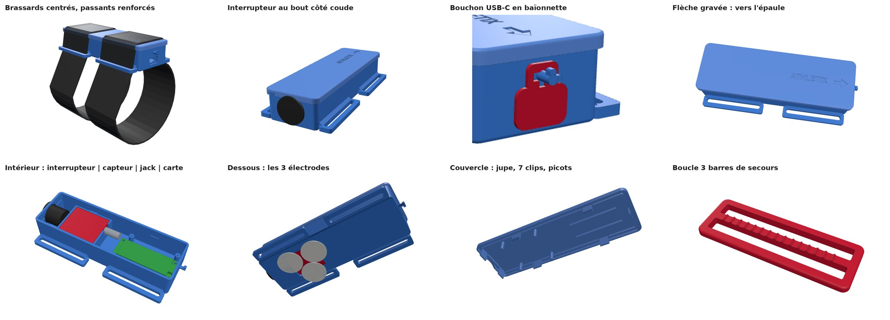
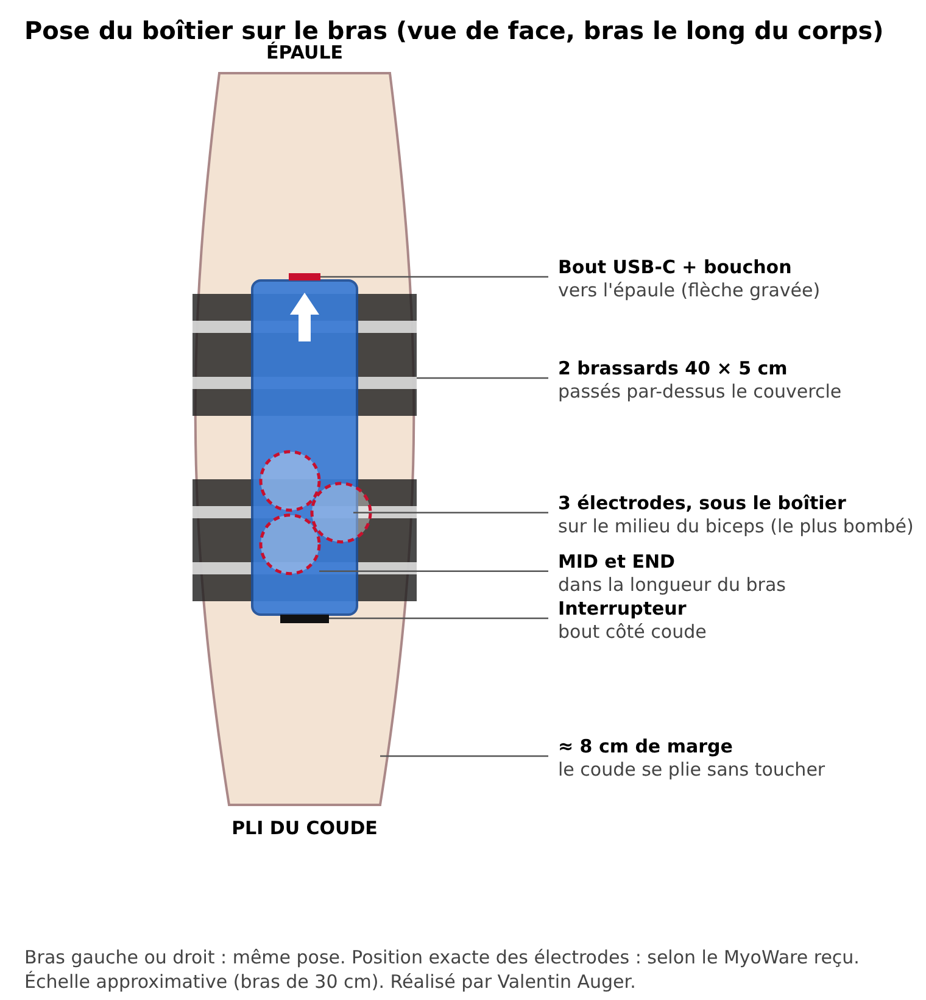
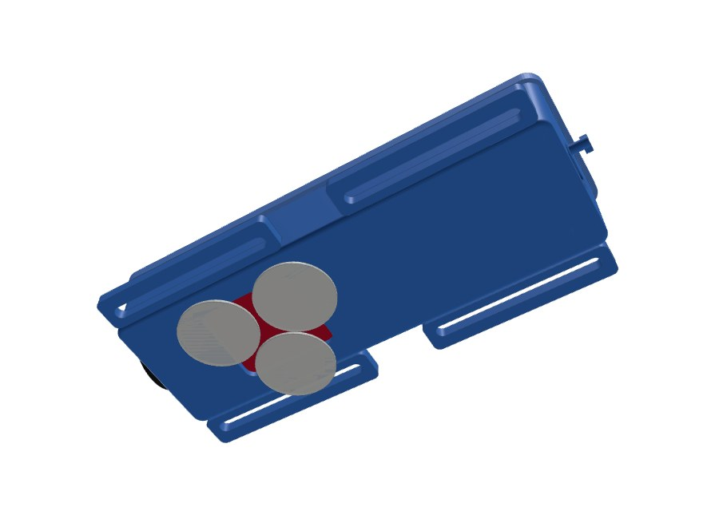
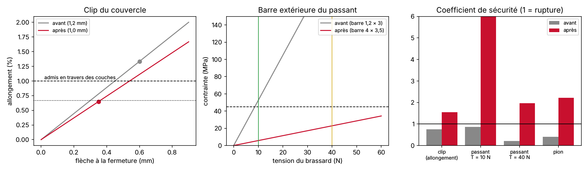
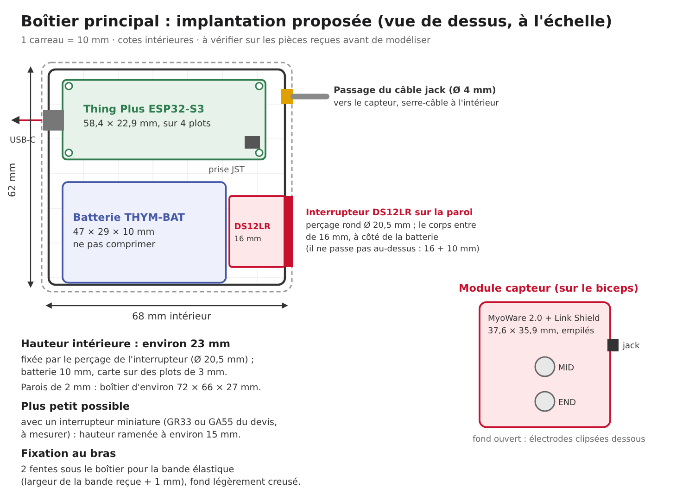

# Boîtier du brassard

Conçu par **Valentin Auger** (novembre 2026), modèle paramétrique en Python (CadQuery). **Un seul boîtier, long et fin, posé sur le biceps.** Chaque pièce est bloquée en X, Y et Z, pour que rien ne bouge quand on court, **sans aucune vis ni insert** : il n'y en a pas dans la commande, tout tient par des clips.

📄 **[Notice de montage et de pose (PDF, 2 pages)](notice-boitier.pdf)** · 🧮 **[Étude de résistance des matériaux](rdm/README.md)** ([page interactive](https://valentin-auger-laboratoire.github.io/athletix-data/boitier-rdm/))

## Où se pose le boîtier, où vont les électrodes

- **Sur le devant du biceps**, dans la longueur du bras. **Flèche gravée et bout USB-C vers l'épaule**, interrupteur vers le coude : le coude se plie sans toucher le boîtier.
- **Les 3 électrodes sont sous le boîtier** : elles se clipsent sous le capteur par l'ouverture du fond, sans ouvrir le boîtier. **MID et END dans la longueur du bras**, sur la partie la plus bombée du biceps ; REF sur sa pastille. Position exacte selon le MyoWare reçu.
- **Bras gauche ou droit : même pose.**
- **Deux brassards réfléchissants du devis** (40 × 5 cm, scratch) passent dans les passants, **par-dessus le couvercle**, et font le tour du bras. Ils plaquent le boîtier, donc les électrodes, sur la peau.

## Ce qui tient chaque pièce

| Pièce | Comment elle est bloquée |
|---|---|
| Couvercle | **7 clips** (languettes souples avec un bec) qui s'enclenchent dans des creux de l'intérieur des parois ; ouverture au tournevis plat par l'encoche côté coude |
| MyoWare + Link Shield | poche à sa taille (X, Y), 4 picots du couvercle sur les coins (Z) |
| Carte Thing Plus ESP32-S3 | 4 plots, 2 pions dans ses trous (X, Y), 4 doigts sous le bac qui appuient sur les anneaux des trous (Z) |
| Batterie | bac à rebords (X, Y), mousse de 1,5 mm et nervures du couvercle (Z), sans l'écraser |
| Bac à batterie | 4 colonnes avec ergots, serré par la batterie |
| Interrupteur | clipsé dans le bout côté coude |
| Bouchon USB-C | serré dans son logement, retenu par le pion en baïonnette (il ne se perd pas) |
| Passants | tenus par la paroi sur toute leur longueur, avec un renfort triangulaire ; barre extérieure de 4 × 3,5 mm |

Le script vérifie à chaque génération qu'**aucune pièce n'en touche une autre** et que tout est plaqué (jeu de 0 mm sur le capteur, la batterie et la carte, couvercle fermé).

## Résistance

Avant d'imprimer, Valentin a fait calculer les trois pièces qui travaillent par la RDM des poutres : **clips du couvercle, barre des passants, pion du bouchon**. Sur le premier modèle, **les trois cassaient**. Le modèle a été corrigé : languette du clip de 1,0 mm, barre du passant de 4 × 3,5 mm au lieu de 1,2 × 3, baïonnette à la place du pion fendu. Toutes les pièces ont maintenant leur marge de sécurité. Détail, hypothèses et limites : **[`rdm/`](rdm/README.md)**, et **[page interactive](https://valentin-auger-laboratoire.github.io/athletix-data/boitier-rdm/)** pour faire varier le matériau et les efforts.

## Pluie

**Résiste à la pluie et à la transpiration, pas étanche.** Le bout USB-C est en haut quand on porte le brassard, donc :
- **jupe du couvercle** (comme le rebord d'une casquette) : l'eau qui coule sur le couvercle tombe à côté du joint ;
- **bouchon USB-C** en PETG, retiré seulement pour charger. Il est retenu par un **pion du boîtier, sans ficelle** (idée de Valentin). Ce pion est une **baïonnette à détrompeur** : 2 ailes rigides qui ne passent dans les encoches de la languette que bouchon retourné, et le couvercle empêche de le retourner. Il ne se perd pas et pivote pour charger. L'étude RDM a montré qu'une tête fendue en 4 aurait cassé ;
- plus de fenêtre sur le couvercle (l'interrupteur ENV / RAW du Link Shield reste sur RAW), interrupteur en bas.

Pas de douche ni de piscine : il faudrait un joint et des électrodes déportées, qui ne sont pas dans la commande. Pistes pour une version étanche : voir le cahier des charges plus bas.

## Fichiers

| Dossier | Contenu |
|---|---|
| [`fichiers/ds12lr/`](fichiers/ds12lr) | version interrupteur rond DS12LR : 137 × 43 × 27 mm (143 × 64 mm avec les passants) |
| [`fichiers/petit-interrupteur/`](fichiers/petit-interrupteur) | version GR33 / GA55 : 133 × 43 × 27 mm |
| [`modele/boitier.py`](modele/boitier.py) | le modèle : chaque cote est un chiffre en haut du fichier, `python boitier.py` refait tous les fichiers |
| [`modele/notice.py`](modele/notice.py) | refait la notice PDF |
| [`rdm/`](rdm/README.md) | l'étude de résistance des matériaux et ses tests |
| [`images/`](images) | rendus et schéma de pose |

Dans chaque version : `boitier`, `couvercle`, `bac-batterie`, `bouchon-usb`, `serre-bande` (boucle 3 barres de secours, si le scratch ne serre pas assez), en **STEP** (Fusion 360, SolidWorks) et **STL** (impression), plus `assemblage-complet.step`. Impression en **PETG** (bobine du devis) : les clips plient d'environ 1,3 %, sans risque en PETG.

**À vérifier au pied à coulisse avant d'imprimer** : hauteur de la pile MyoWare + Link Shield et position de la prise jack, pressions des électrodes dans l'ouverture (30 × 27 mm), trous de la carte, petit interrupteur (15 × 10 × 12 mm supposés), épaisseur du brassard (2 mm supposés). Liste complète dans la [notice](notice-boitier.pdf).

---

# Cahier des charges de départ

Préparé par **Valentin Auger** (novembre 2026) pour modéliser le boîtier sous Fusion 360, avant de recevoir les pièces. Les dimensions viennent des fiches des fabricants et des revendeurs : **à vérifier au pied à coulisse** sur les pièces reçues avant d'imprimer.

> Première étude (deux modules, vis M2,5). Le boîtier réalisé plus haut la remplace : **un seul boîtier, sans vis**. Le tableau des pièces et les pistes pour une version étanche restent valables.

## Deux modules sur le brassard

| Module | Contenu | Où |
|---|---|---|
| **Capteur** | MyoWare 2.0 + Link Shield empilés | posé **sur le biceps** : les électrodes MID et END se clipsent dessous, le fond reste ouvert |
| **Boîtier principal** | carte Thing Plus ESP32-S3, batterie, interrupteur | sur le brassard, à côté du capteur, relié par le câble jack |

## Pièces et dimensions

| Pièce | Dimensions | Ce qui compte pour le boîtier | Source |
|---|---|---|---|
| SparkFun Thing Plus ESP32-S3 | 58,4 × 22,9 mm (2,30 × 0,90 po) | 4 trous de fixation (vis 4-40, ≈ M2,5) ; USB-C sur un petit côté ; prise batterie JST sur la carte | [documentation SparkFun](https://docs.sparkfun.com/SparkFun_Thing_Plus_ESP32-S3/hardware_overview/) |
| MyoWare 2.0 | 37,6 × 35,9 mm | électrodes clipsées dessous ; témoins lumineux dessus | [guide SparkFun](https://learn.sparkfun.com/tutorials/getting-started-with-the-myoware-20-muscle-sensor-ecosystem/myoware-20-muscle-sensor) |
| Link Shield | 37,6 × 35,9 mm (même gabarit, empilé) | prise jack 3,5 mm sur le côté ; interrupteur ENV / RAW accessible | [guide SparkFun](https://learn.sparkfun.com/tutorials/getting-started-with-the-myoware-20-muscle-sensor-ecosystem/-myoware-20-link-shield) |
| Batterie THYM-BAT 3,7 V 1 500 mAh | 47 × 29 × 10 mm, 28 g, câble ≈ 80 mm | connecteur JST-PH 2 mm ; **protection contre la surcharge et les courts-circuits intégrée** ; ne pas comprimer | fiche Gotronic (une seule source, à vérifier) |
| Interrupteur DS12LR | perçage rond **Ø 20,5 mm**, corps de **16 mm** de profondeur, cosses de 8 mm | interrupteur à bascule à clipser, avec **voyant rouge** qui demande une résistance | fiche Gotronic (une seule source, à vérifier) |
| Câble audio recyclé | Ø ≈ 3 à 4 mm | passage dans la paroi avec serre-câble intérieur | à mesurer |
| Bande élastique | largeur à mesurer | 2 fentes sous chaque module | à mesurer |

**Les résistances de 150 Ω du devis** servent très probablement au voyant de l'interrupteur DS12LR (une LED a besoin d'une résistance en série). Sur la batterie (3,7 V), le voyant consommerait environ 10 mA en permanence : à câbler seulement si on veut voir que le brassard est allumé, ou à laisser de côté pour gagner de l'autonomie.

## Exigences

| # | Exigence | Valeur |
|---|---|---|
| E1 | Le boîtier principal contient la carte, la batterie et l'interrupteur, sans comprimer la batterie | intérieur ≈ 68 × 62 × 23 mm (voir le schéma), 1 mm de jeu autour de la batterie |
| E2 | La carte est fixée et démontable | 4 plots de 3 mm de haut, vis M2,5 ou inserts |
| E3 | On peut recharger et programmer sans ouvrir | ouverture USB-C sur la paroi, ≈ 10 × 4 mm, alignée sur la prise de la carte |
| E4 | On allume et éteint sans ouvrir | interrupteur sur une paroi latérale, à côté de la batterie (il ne passe pas au-dessus : 16 + 10 mm de hauteur) |
| E5 | Le câble jack ne s'arrache pas | passage Ø 4–5 mm + serre-câble ou nœud à l'intérieur |
| E6 | Le capteur garde le contact avec la peau | module capteur à fond ouvert, électrodes accessibles ; le Link Shield (prise jack, interrupteur ENV) reste accessible |
| E7 | Tenue sur le bras | 2 fentes par module pour la bande élastique, fond légèrement creusé (rayon ≈ 40–50 mm) |
| E8 | Pas d'arête vive contre la peau | congés de 1 à 2 mm |
| E9 | Imprimable avec le PETG du devis | parois de 2 mm, jeu d'assemblage + 0,3 mm, pas de supports à l'intérieur si possible |
| E10 | Masse raisonnable | objectif : moins de 100 g avec la batterie (batterie 28 g) |

Boîtier principal obtenu : **environ 72 × 66 × 27 mm**. Il peut descendre à environ 15 mm d'épaisseur avec un interrupteur miniature (GR33 ou GA55 du devis, à mesurer à la réception).

## Version étanche (natation, plus tard)

Le prototype actuel **n'est pas étanche** ([analyse des risques](../../gestion-projet/analyse-des-risques.md)). Pour aller dans l'eau, il faudrait :

| Point faible | Solution possible |
|---|---|
| Couvercle | joint torique ou joint en TPU imprimé dans une gorge, 4 à 6 vis |
| Câble jack | presse-étoupe (PG7, câble de 3 à 6 mm) ou passage noyé dans du silicone |
| Interrupteur | le capuchon DS12CAP protège seulement des éclaboussures : pour l'immersion, interrupteur à l'intérieur (on ouvre pour allumer) ou interrupteur à aimant (ILS) |
| USB-C | pas de prise étanche : recharger couvercle ouvert |
| Module capteur | le MyoWare n'est pas fait pour l'eau, et les électrodes collent mal sur une peau mouillée : vernis de protection sur la carte, essais courts |

Avant d'y mettre l'électronique : boîtier **vide** immergé 30 minutes avec un papier absorbant à l'intérieur, qui doit ressortir sec.

## Avant d'imprimer

- [ ] Mesurer chaque pièce reçue et corriger le tableau ci-dessus.
- [ ] Vérifier la position exacte de l'USB-C et des trous de la carte (dessin de la carte sur la documentation SparkFun).
- [ ] Choisir l'interrupteur : DS12LR (gros, avec voyant) ou GR33 / GA55 (plus petits).
- [ ] Mesurer la largeur de la bande élastique.
- [ ] Imprimer d'abord une version d'essai rapide (parois fines) pour vérifier les cotes.
