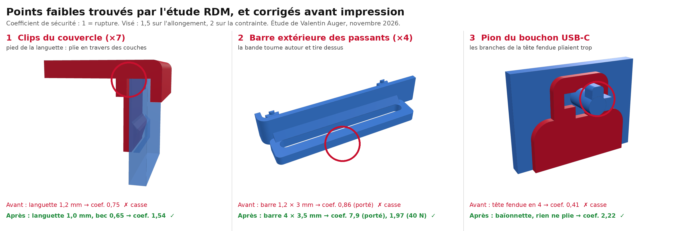
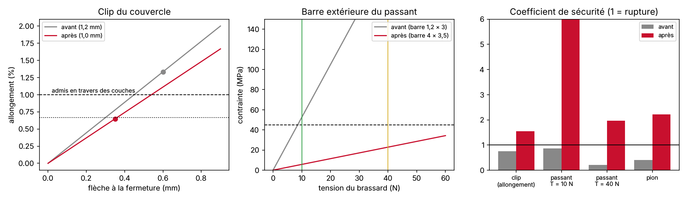

# Étude de résistance des matériaux du boîtier

Étude de **Valentin Auger** (novembre 2026), faite avant d'imprimer et avant les captures finales sous Fusion 360. Les trois pièces du boîtier qui **travaillent** sont calculées à la main par la RDM des poutres, sur le **premier modèle**. On cherche le point faible, on corrige le modèle ([`../modele/boitier.py`](../modele/boitier.py)), puis on recalcule avec les mêmes hypothèses.

🖥️ **[Page interactive](https://valentin-auger-laboratoire.github.io/athletix-data/boitier-rdm/)** : mêmes formules, tous les paramètres réglables, premier modèle et modèle corrigé.

## Résultat

| Pièce | Critère | Premier modèle | Modèle corrigé | Visé |
|---|---|---|---|---|
| Clip du couvercle | allongement à la fermeture (en travers des couches, admis 1,0 %) | 1,33 % → coef. 0,75 ❌ | 0,65 % → coef. 1,54 ✅ | ≥ 1,5 |
| Clips (×7) | tenue du couvercle / effort à tenir (8,1 N) | 74 N → coef. 9,2 | 25 N → coef. 3,1 ✅ | ≥ 2 |
| Clips (×7) | effort pour fermer à la main | 35 N | 9 N | facile |
| Barre du passant | brassard porté, T = 10 N | 52 MPa → coef. 0,86 ❌ | 5,7 MPa → coef. 7,9 ✅ | ≥ 2 |
| Barre du passant | brassard tiré très fort, T = 40 N | 210 MPa → coef. 0,21 ❌ | 23 MPa → coef. 1,97 ✅ | ≥ 1,5 |
| Pion du bouchon | avant : enfoncer la tête fendue (admis 2,0 %) ; après : bouchon tiré à 10 N | 4,9 % → coef. 0,41 ❌ | tige 14 MPa, aile 11 MPa → coef. 2,2 ✅ | ≥ 2 |

**Trois pièces cassaient sur le premier modèle.** Ce n'était pas celle qu'on soupçonnait le plus : la barre des passants était la plus faible, et la tête fendue du pion cassait dès le premier enfoncement.

## Les corrections apportées au modèle

| Pièce | Premier modèle | Modèle corrigé | Pourquoi |
|---|---|---|---|
| **Clips du couvercle** | languette 1,2 mm, bec 0,9 mm | languette **1,0 mm**, bec **0,65 mm** (0,35 mm accroché) | la languette plie **en travers des couches** d'impression, où le PETG est le plus faible. Elle tient encore le couvercle avec une marge de 3 |
| **Barre extérieure des passants** | 1,2 × 3 mm | **4 × 3,5 mm** (passant de 8 → 10,5 mm de large) | la bande tourne autour de cette barre et tire dessus. La contrainte est **divisée par 9** |
| **Pion du bouchon** | tête fendue en 4, Ø 2,6 mm | **baïonnette à détrompeur** : tige Ø 3 mm et 2 ailes rigides | les branches de la tête fendue pliaient à 4,9 % pour 2 % admis. Avec la baïonnette, rien ne plie : le bouchon ne s'enfile que retourné à 180°, et le couvercle posé empêche de le retourner |

## Hypothèses

**Matériau : PETG imprimé** (bobine du devis). Ce sont des valeurs typiques de fiches de filaments, que l'impression modifie : à confirmer par un essai.

| Grandeur | Valeur |
|---|---|
| Module d'Young E | 2 000 MPa |
| Résistance dans le plan des couches | 45 MPa |
| Résistance en travers des couches (adhérence entre couches) | 25 MPa |
| Allongement admis pour un clip : dans le plan / en travers des couches | 2 % / 1 % |
| Frottement PETG sur PETG | 0,3 |

**Chargements**

| Cas | Valeur | D'où ça vient |
|---|---|---|
| Course | 10 g sur le haut du bras | le choc du pied donne 3 à 5 g sur le haut du bras ; marge × 2 |
| Masse qui appuie sur le couvercle | 62 g | batterie 28, capteur 10, carte 8, bac 4, couvercle 12 |
| Mousse sous la batterie | 2 N | serrée par les nervures |
| Brassard porté | 10 N de tension | ≈ 2 kPa sur le bras (serré sans gêner), plus les chocs |
| Brassard tiré très fort au serrage | 40 N | cas exceptionnel |
| Bouchon tiré ou accroché dans un vêtement | 10 N | cas exceptionnel |

**Coefficients visés** : 1,5 sur l'allongement des clips, 2 sur la contrainte (1,5 pour le serrage brutal).

## Les calculs

### 1. Clips du couvercle : languette en porte-à-faux

À la fermeture, le bec doit passer la paroi : la languette plie de **y = bec − jeu** (jeu de 0,3 mm entre la lèvre du couvercle et la paroi).

- Allongement à l'encastrement : **ε = 1,5 · t · y / L²**
- Effort qui plie la languette : **P = 3 · E · I · y / L³**, avec I = b · t³ / 12
- Effort pour fermer (rampe du bec, pente α = atan(bec / 2 mm)) et pour arracher (face d'accroche à 45°) : **W = P · (μ + tan α) / (1 − μ · tan α)**, multiplié par 7 clips
- À tenir en course : 62 g × 10 g + 2 N de mousse = **8,1 N**

Le couvercle s'imprime face gravée sur le plateau, donc les languettes poussent vers le haut. Elles plient **en travers des couches**, et c'est l'adhérence entre couches qui limite : on admet 1 % au lieu de 2 %.

### 2. Barre extérieure des passants : poutre encastrée aux deux bouts

La bande descend du bord du couvercle vers la fente, puis repart en suivant le bras (rayon 50 mm). Elle **tourne d'un angle Δ ≈ 51° autour de la barre extérieure** et la pousse avec un effort **R = 2 · T · sin(Δ/2)** (direction calculée à partir de la géométrie).

- La bande fait 50 mm de large sur une barre de 51 mm : charge répartie, barre encastrée à ses deux bouts
- Moment aux encastrements : **M = R · L / 12**
- Contrainte : **σ = M / W**, avec W = h · b² / 6, calculé dans chaque direction de R
- La barre est horizontale sur le plateau : elle plie **dans le plan des couches** (45 MPa admis)

### 3. Pion du bouchon

- **Premier modèle, tête fendue en 4** : chaque branche est une petite languette de 3,4 mm qui plie de (Ø tête − Ø trou) / 2 = 0,4 mm, soit ε = 1,5 · t · y / L² = **4,9 %**. Elle casse dès le premier enfoncement.
- **Modèle corrigé, baïonnette** : rien ne plie. On vérifie la tenue si le bouchon est tiré à 10 N. Pour la tige, en flexion au pied : σ = 32 · F · l / (π · d³) = 14 MPa, dans le plan des couches. Pour l'aile du haut, qui prend tout l'effort seule : σ = F · porte-à-faux / (b · e² / 6) = 11 MPa, en travers des couches.

## Limites

- **RDM des poutres** : pas de concentration de contrainte aux angles (les congés la réduisent), pas de calcul par éléments finis. C'est la même approche que l'[outil aileron](https://valentin-auger-laboratoire.github.io/portfolio/outils/aileron/) du portfolio.
- **Propriétés du PETG imprimé** : elles varient selon l'imprimante, la température et le remplissage. À confirmer avec une pièce d'essai : clipser et déclipser le couvercle 20 fois, tirer sur un passant avec un peson.
- Ces chargements sont des **hypothèses raisonnées, pas des mesures**. On peut les faire varier sur la page interactive.

## Fichiers

| Fichier | Rôle |
|---|---|
| [`rdm.py`](rdm.py) | les calculs : `python rdm.py` écrit `resultats.json`, `resultats.md` et la figure |
| [`test_rdm.py`](test_rdm.py) | vérifie que les cotes de l'étude sont celles du modèle (18 vérifications) |
| [`test_rdm.js`](test_rdm.js) | vérifie que la page interactive calcule exactement comme `rdm.py` (72 vérifications) |
| [`../../../web/boitier-rdm/`](../../../web/boitier-rdm/) | la page interactive (publiée avec la démo de l'application) |
