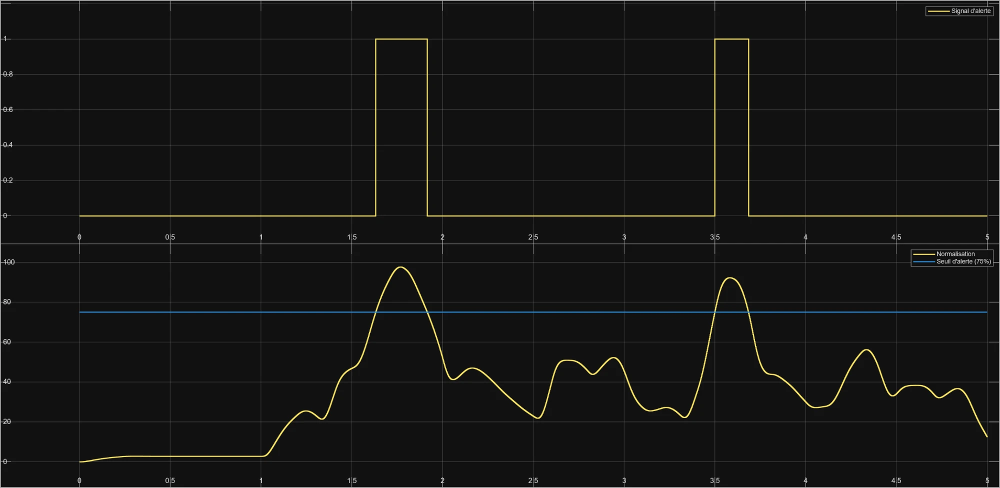

# Simulation Simulink de la chaîne EMG

**🇫🇷 Français** · [🇬🇧 English](#english)

Avant de câbler le brassard, l'équipe a modélisé sous **Simulink** toute la chaîne de mesure musculaire : du signal du muscle jusqu'à l'alerte envoyée à l'application. Le modèle s'appelle `AthletixData_EMG_Simulation`.

## La chaîne modélisée

| Étape | Bloc Simulink | Réglage |
|---|---|---|
| **Signal du muscle** | bruit blanc limité en bande × contraction à t = 1 s | puissance 0,1, période 0,1 s, graine 23341 |
| Parasite du secteur | sinusoïde | 50 Hz, 0,08 V |
| **MyoWare 2.0** | redressement double alternance (\|u\|) | |
| | filtre passe-bas d'ordre 2 (enveloppe) | 5 Hz |
| **ESP32-S3** | échantillonneur | 500 Hz (2 ms) |
| | quantification du convertisseur | 12 bits sur 0–3,3 V (0,806 mV par pas) |
| | saturation | 0 à 3,3 V |
| | valeur efficace glissante | carré, moyenne sur 100 échantillons (200 ms), racine |
| | normalisation | ×100 / 1,85 V → % de la contraction maximale (MVC) |
| | alerte | ≥ 75 % MVC |

## Lecture du résultat (5 s simulées)

- Au repos (avant 1 s), l'intensité reste à environ **3 %** : c'est le résidu du 50 Hz après redressement et filtrage.
- Après 1 s, deux passages au-dessus de **75 %** déclenchent l'alerte : de 1,63 à 1,92 s, puis de 3,50 à 3,69 s.

## Limites connues, et corrections prévues

Le modèle a été relu en novembre 2026. La chaîne de traitement est cohérente avec le matériel (MyoWare 2.0, convertisseur 12 bits de l'ESP32-S3, fenêtre de 200 ms), mais plusieurs points sont à corriger avant de s'en servir pour conclure :

1. **Le signal musculaire est trop lent.** Le bruit change de valeur toutes les 0,1 s : c'est un escalier à 10 Hz, alors qu'un vrai signal musculaire s'étend de 20 à 450 Hz. Comme l'effort simulé est constant après 1 s, les deux pics viennent du tirage aléatoire et non d'un effort plus fort : avec une autre graine, on obtient un pic à 120 %.
   → Correction prévue : bruit échantillonné à 2 kHz, filtre passe-bande 20–450 Hz et un vrai profil d'effort (repos, 40 %, 95 %, 50 %, repos). Vérifiée par une reproduction en Python : l'intensité affichée suit alors l'effort demandé (40 % → 40–43 %, 95 % → 95–97 %), quel que soit le tirage.
2. **L'alerte mesure l'intensité, pas la fatigue.** Un seuil sur le % MVC repère un effort intense. La fatigue se détecte autrement, par exemple par la baisse de la fréquence médiane du signal brut (sortie RAW du MyoWare échantillonnée à 1 kHz ou plus).
   → Correction prévue : renommer en « alerte d'effort intense » et ajouter une hystérésis (alerte à 75 %, fin d'alerte à 70 %) pour qu'elle ne clignote pas autour du seuil.
3. **La référence des 100 % (1,85 V) est supposée.** En vrai, elle se mesure pendant une contraction maximale de calibration, propre à chaque personne.
4. **Le signal est exprimé en volts dès le muscle.** Sur la peau, il est de l'ordre du millivolt : c'est le MyoWare qui l'amplifie. Le modèle corrigé ajoutera ce gain.

Le fichier `.slx` sera ajouté ici une fois ces corrections faites.

---

## Simulink simulation of the EMG chain (English)

Before wiring the armband, the team modelled the whole muscle-measurement chain in **Simulink**: muscle signal and 50 Hz interference, MyoWare 2.0 (full-wave rectification + 5 Hz envelope filter), ESP32-S3 (500 Hz sampling, 12-bit ADC on 0–3.3 V, 200 ms moving RMS, normalisation to % of maximum voluntary contraction) and an alert at ≥ 75 % MVC.

**Known limits (reviewed in November 2026):** the muscle signal is a 10 Hz staircase rather than a 20–450 Hz signal, so the two peaks come from the random draw, not from a stronger effort; the alert detects high intensity, not fatigue; the 100 % reference (1.85 V) is assumed. Planned corrections: 2 kHz noise with a 20–450 Hz band-pass, a real effort profile, a MyoWare gain stage, a 75/70 % hysteresis on the alert. The `.slx` file will be added once corrected.
