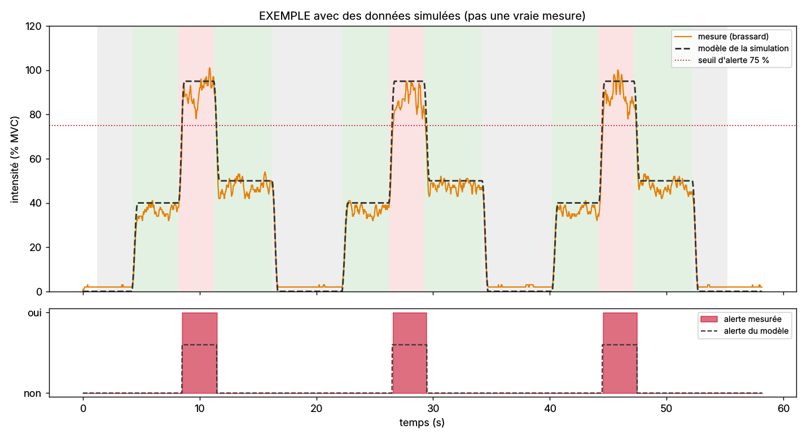

# Comparer le vrai brassard à la simulation

Prêt **avant** l'arrivée du matériel : dès que le brassard marche, une séance enregistrée est comparée automatiquement au modèle de la simulation Simulink ([`hardware/simulation-emg/`](../hardware/simulation-emg/README.md)), avec les critères du [protocole de test](../hardware/PROTOCOLE-DE-TEST.md).

## Le jour de l'essai

1. Firmware final téléversé, avec `JOURNAL_SERIE = true` (déjà le cas) : pendant une mesure, le brassard écrit chaque valeur sur le port USB (`M,ms,mV,RMS,intensité,alerte`, 50 lignes par seconde).
2. Brassard branché au PC par l'USB-C, calibration faite, séance lancée dans l'application.
   ⚠️ **Électrodes sur la peau : PC portable débranché du secteur** (sur sa batterie), ou isolateur USB. Un PC raccordé au secteur pourrait, en cas de défaut de son alimentation, faire passer un courant par la peau ([analyse des risques](../gestion-projet/analyse-des-risques.md)).
3. Enregistrer :
   ```bash
   pip install -r mesures/requirements.txt
   python mesures/capturer.py COM3 essai-1.txt --duree 60
   ```
   (sous Linux : `/dev/ttyACM0` ; sans Python, copier le moniteur série de l'IDE Arduino dans un fichier, cela marche aussi)
4. Pendant ce temps, suivre **au moins deux fois** le cycle d'effort de la simulation, biceps contracté :

   | 3 s | 4 s | 3 s | 5 s | 3 s |
   |---|---|---|---|---|
   | repos | effort moyen (≈ 40 %) | effort fort (≈ 95 %) | effort moyen (≈ 50 %) | repos |

5. Comparer :
   ```bash
   python mesures/comparer_simulation.py essai-1.txt
   ```
   Le script retrouve tout seul le début du premier cycle, puis produit `essai-1-comparaison.png` (mesure et modèle superposés) et `essai-1-rapport.md` (critères conformes ou non, valeurs phase par phase).

## Ce qui est vérifié

| Critère | Attendu | Pourquoi |
|---|---|---|
| Intensité au repos | moins de 10 % | le capteur ne mesure presque rien sans effort |
| Effort moyen | entre 20 et 65 % | une vraie personne ne fait jamais exactement 40 % |
| Effort fort | au moins 75 % | il doit déclencher l'alerte |
| Alerte | exactement une par effort fort | l'hystérésis 75 % / 70 % fonctionne |
| Alerte qui clignote | autant d'allumages que de cycles | pas de clignotement près du seuil |
| Saturation | moins de 1 % du temps | électrode bien posée, gain correct |
| Temps de montée vers l'effort fort | au plus 1 s | fenêtre RMS de 200 ms + réaction du muscle |
| Ressemblance avec le modèle | corrélation d'au moins 0,8 | la forme générale suit la consigne |

## Exemple (données simulées, pas une vraie mesure)

`generer_exemple.py` fabrique une fausse séance au format du firmware (effort humain imparfait, léger retard, bruit et secteur à 50 Hz sur la sortie ENV du MyoWare) pour tester la chaîne avant d'avoir le brassard. Résultat : [`exemple/seance-simulee-rapport.md`](exemple/seance-simulee-rapport.md).



## Fichiers

| Fichier | Rôle |
|---|---|
| `modele.py` | modèle de référence : profil d'effort de la simulation, RMS sur 200 ms, alerte 75 / 70 % |
| `capturer.py` | enregistre le port USB du brassard dans un fichier |
| `comparer_simulation.py` | aligne la mesure sur le modèle, calcule les critères, produit la figure et le rapport |
| `generer_exemple.py` | fausse séance pour tester sans matériel |

Testés par `python -m unittest discover -s tests/mesures` (12 tests), relancés par GitHub à chaque envoi.
