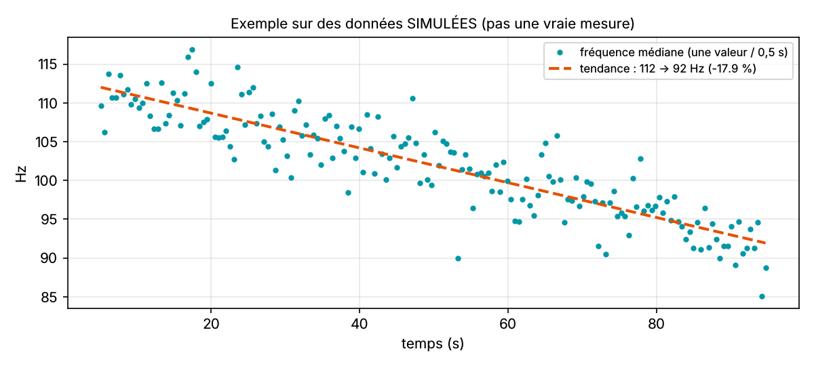

# Fatigue mesurée : fatigue-simulee.txt

| Grandeur | Valeur |
|---|---|
| Valeurs avec effort | 176 sur 90 s |
| Fréquence médiane au début (tendance) | 112.0 Hz |
| Fréquence médiane à la fin (tendance) | 91.9 Hz |
| Baisse | 17.9 % (-13.45 Hz/min) |
| Dispersion autour de la tendance | ± 3.0 Hz |
| Fréquence moyenne (MNF) | 117.2 Hz |

**Lecture : fatigue nette du muscle.** Repères usuels : une baisse de 10 à 30 % accompagne un effort qui fatigue. Repère d'un prototype étudiant, pas un avis médical.
