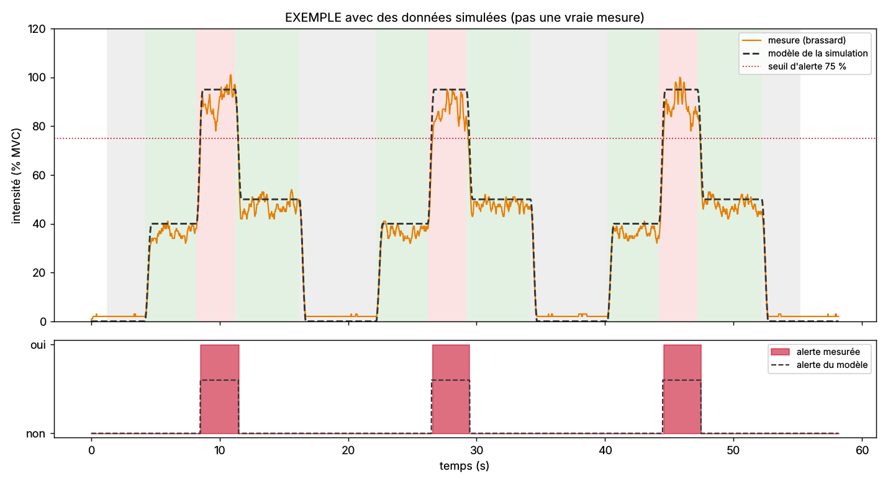

# Comparaison avec la simulation

Journal : `seance-simulee.txt` · 2910 mesures · 58.2 s · 3 cycle(s) complet(s), début du premier cycle à 1.20 s.

| Critère | Mesuré | Attendu | Conforme |
|---|---|---|---|
| Intensité, repos | 2 % | moins de 10 % | ✅ |
| Intensité, effort moyen | 42 % | entre 20 et 65 % (consigne 40–50 %) | ✅ |
| Intensité, effort fort | 89 % | au moins 75 % (déclenche l'alerte) | ✅ |
| Alerte pendant l'effort fort | 1 / 1 / 1 par cycle | exactement 1 par cycle | ✅ |
| Alerte qui clignote | 3 allumage(s) pour 3 cycle(s) | autant d'allumages que de cycles | ✅ |
| Saturation du convertisseur | 0.0 % du temps | moins de 1 % | ✅ |
| Temps de montée vers l'effort fort | 0.32 s (modèle 0.28 s) | au plus 1 s (fenêtre RMS de 200 ms + réaction du muscle) | ✅ |
| Ressemblance avec le modèle | corrélation 1.00 | au moins 0,8 | ✅ |

| Cycle | Phase | Consigne | Moyenne mesurée | Écart type | Maximum |
|---|---|---|---|---|---|
| 1 | repos | 0 % | 2.0 % | 0.2 | 3 % |
| 1 | effort moyen | 40 % | 36.1 % | 2.1 | 41 % |
| 1 | effort fort | 95 % | 89.7 % | 5.0 | 101 % |
| 1 | effort moyen | 50 % | 47.1 % | 3.0 | 54 % |
| 1 | repos | 0 % | 2.0 % | 0.0 | 2 % |
| 2 | repos | 0 % | 2.1 % | 0.2 | 3 % |
| 2 | effort moyen | 40 % | 36.6 % | 2.3 | 41 % |
| 2 | effort fort | 95 % | 87.7 % | 4.2 | 95 % |
| 2 | effort moyen | 50 % | 47.7 % | 1.9 | 52 % |
| 2 | repos | 0 % | 2.0 % | 0.2 | 3 % |
| 3 | repos | 0 % | 2.3 % | 0.4 | 3 % |
| 3 | effort moyen | 40 % | 36.5 % | 1.9 | 41 % |
| 3 | effort fort | 95 % | 89.4 % | 5.4 | 100 % |
| 3 | effort moyen | 50 % | 47.7 % | 2.6 | 53 % |
| 3 | repos | 0 % | 2.1 % | 0.3 | 3 % |

Écart moyen avec le modèle (RMS) : 4.4 points. Il dépend surtout de l'effort réellement fourni par la personne : le modèle suit exactement la consigne.
